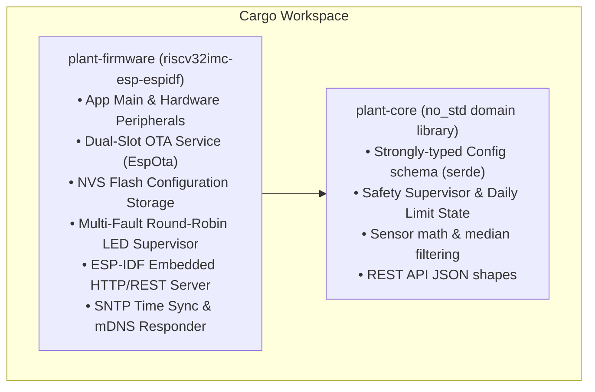
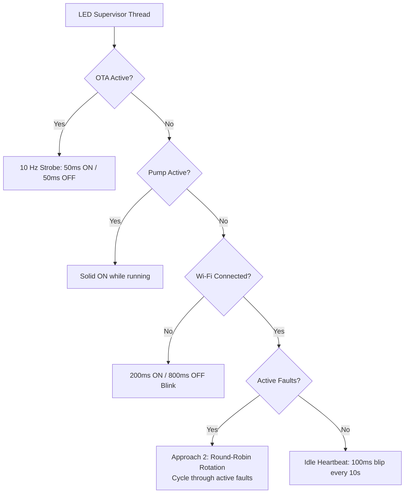

# Plant Monitor ESP32-C3: System Specification & Architecture

## 1. Executive Summary & Objective

The **Plant Monitor ESP32-C3** project is an industrial-grade automated plant irrigation, soil health telemetry, and environmental monitoring system. Originally conceived on the Raspberry Pi Pico W (MicroPython) and later prototyped in C++/PlatformIO, the project has matured into a **bare-metal, memory-safe Rust** implementation targeting the **ESP32-C3 SuperMini** (32-bit RISC-V) running on **ESP-IDF**.

The system addresses the historical pitfalls of microcontroller IoT (heap exhaustion, blocking garbage collection, SPI flash degradation, router reconnection drops, and risky firmware updates) by introducing:
1. **Memory-Safe Bare-Metal Rust:** Zero heap fragmentation, deterministic concurrency, compile-time safety invariants, and strict separation between domain logic (`plant-core`) and peripheral drivers (`plant-firmware`).
2. **Dual-Slot A/B Over-The-Air (OTA) Updates:** Custom 4MB partition table (`ota_0` and `ota_1`) with hardware bootloader rollback (`CONFIG_BOOTLOADER_APP_ROLLBACK_ENABLE`). If a newly flashed firmware panics or fails to validate itself, the bootloader automatically reverts to the previous working slot.
3. **GitHub Releases Cloud Deployment:** Web UI integrates directly with the GitHub Releases API to display release notes and target versions in an interactive confirmation modal, downloading and streaming signed HTTPS firmware directly into flash.
4. **Resilient Networking & NVS Persistence:** Saved Wi-Fi credentials and full device configuration are stored in ESP32 NVS flash, surviving OTA transitions. A 5-attempt WPA3-SAE retry loop prevents connection drops after warm reboots, with an automatic SoftAP fallback and 5-minute self-healing recovery timer.
5. **Deterministic Multi-Fault Visual Telemetry:** Dedicated round-robin status LED supervisor communicating active hardware faults, pump activity, Wi-Fi status, and a 10 Hz strobe during flash writing.
6. **Automated CI/CD Release Automation:** GitHub Actions runner compiles release binaries on tag push (`v*.*.*`), leverages dual-tier build caching (`rust-cache` and `.embuild`), and publishes `.bin` assets directly to GitHub Releases.

---

## 2. Hardware Architecture & Electrical Specifications

### 2.1 Microcontroller: ESP32-C3 SuperMini
* **Authoritative Physical Pinout Reference:** [LastMinuteEngineers ESP32-C3 SuperMini Pinout Reference](https://lastminuteengineers.com/esp32-c3-super-mini-pinout-reference/)
* **Core:** 32-bit single-core RISC-V processor clocked at 80 MHz / 160 MHz.
* **Memory:** 400 KB SRAM, 4 MB embedded SPI Flash (DIO mode, 40 MHz).
* **Connectivity:** Integrated 2.4 GHz 802.11b/g/n Wi-Fi (WPA2/WPA3-SAE) & Bluetooth 5 (LE).
* **Power Source:** 5V via USB-C or external VIN; onboard 3.3V low-dropout regulator (LDO).
* **Status LED:** Single blue LED tied to **GPIO 8 (Active LOW)**.
* **Hardware USB:** Native USB Serial/JTAG on GPIO 18 (D-) and GPIO 19 (D+). *Reserved exclusively for debugging and USB flashing.*
* **Internal Silicon Telemetry:** Silicon junction temperature read via internal sensors.

### 2.2 Complete Pin & Peripheral Mapping

All pin assignments strictly follow the canonical [LastMinuteEngineers ESP32-C3 SuperMini Pinout Reference](https://lastminuteengineers.com/esp32-c3-super-mini-pinout-reference/):

| ESP32-C3 Pin | Connected Component | Function & Conditioning | Direction / Mode |
| :--- | :--- | :--- | :--- |
| **GPIO 0** | 18650 Battery Monitor | ADC1_CH0 via 100kΩ/100kΩ divider (R8/R9) + 100nF (C6) from TB4 Pin 3 | Analog IN |
| **GPIO 1** | Ambient Light Sensor | ADC1_CH1 via LDR1 + 10kΩ divider (R7) + 100nF (C4) | Analog IN |
| **GPIO 2** | Strapping Protected | **Unconnected / High-Z** (Guarantees zero boot hangs) | High-Z |
| **GPIO 3** | Capacitive Soil Sensor | ADC1_CH3 connected to TB2 Pin 1 (`AOUT`) + 100nF filter (C2) | Analog IN |
| **GPIO 4** | 5V Supply Rail Monitor | ADC1_CH4 via 100kΩ/100kΩ divider (R1/R2) + 100nF filter (C1) | Analog IN |
| **GPIO 5** | I2C SCL | I2C Clock bus for optional SHT30 / BH1750 environmental modules | Open Drain |
| **GPIO 6** | I2C SDA | I2C Data bus for optional SHT30 / BH1750 environmental modules | Open Drain |
| **GPIO 7** | Ultrasonic Sensor `TRIG`| 10 µs trigger pulse output to HC-SR04 (TB1 Pin 2) | Digital OUT |
| **GPIO 8** | Onboard Status LED | Active LOW blue LED (Active: 0, Inactive: 1) | Digital OUT |
| **GPIO 9** | BOOT Button | Onboard tactile button (pulls LOW when pressed) | Digital IN |
| **GPIO 10** | Pump MOSFET Gate | Digital output to AO3400A / FQP30N06L Gate via 1kΩ (R5) + 100kΩ pull-down (R6) | Digital OUT |
| **GPIO 20** | Ultrasonic Sensor `ECHO`| Digital input via 1kΩ/2kΩ divider (R3/R4) stepping 5V down to 3.3V (TB1 Pin 3) | Digital IN |
| **GPIO 21** | Switched Soil Sensor VCC | Digital switched 3.3V power to TB2 Pin 2 (Duty-cycled reading) | Digital OUT |

### 2.3 Actuator & Sensor Conditioning Circuitry
* **Low-Side Pump Driver:** N-Channel logic-level MOSFET (AO3400A SMD or FQP30N06L TO-220).
  * **Gate Pull-Down (R6, 100 kΩ):** Held firmly to GND to keep the pump disabled during bootloader startup, brownouts, and chip resets.
  * **Gate Damping (R5, 1 kΩ):** Protects GPIO 10 against inrush capacitance and ringing.
  * **Flyback Diode (D1, 1N4001 / 1N5819 / SS34):** Clamps inductive voltage spikes across pump motor terminals.
  * **Bulk Decoupling (C3, 100 µF):** Dampens transient motor startup current dips on the 5V bus.
* **Acoustic Ultrasonic Rangefinder (HC-SR04):**
  * Powered from 5V rail for reliable transducer range.
  * 1kΩ / 2kΩ resistive voltage divider steps the 5V `ECHO` output down to a 3.3V-safe logic level into GPIO 20.
  * Firmware implements a strict 30 ms timeout and software un-latch reset pulse to clear stuck third-party clone sensors.
* **Corrosion-Resistant Capacitive Soil Moisture Sensor:**
  * Switched power from GPIO 21 eliminates continuous galvanic bias in damp soil.
  * Analog `AOUT` sampled on GPIO 3 (`ADC1_CH3`) with 100nF filter capacitor.

---

## 3. Firmware Architecture & Rust Workspace

The firmware is structured as a Cargo workspace separating hardware-independent domain modeling from hardware-specific HAL drivers.



### 3.1 `plant-core` (Domain Logic)
* **`no_std` Architecture:** Compiles without `std` for native desktop testing and simulation.
* **`config.rs`:** Strict Serde-compatible data contracts defining system, gauge, timing, and safety configurations with automatic validation and sensible defaults.
* **`safety.rs`:** Sliding-window watering limiter tracking cumulative daily watering time against configured limits (e.g. 93 seconds/day), enforcing minimum inter-cycle cooldown periods (e.g. 300 seconds), and inhibiting night-time cycles.
* **`sensors.rs`:** Physics conversions for ADC millivolts to percentage, ultrasonic travel time to centimeters, and plausibility boundary validators.

### 3.2 `plant-firmware` (Hardware Application)
* **Target:** `riscv32imc-esp-espidf` using ESP-IDF v5.x.
* **NVS Flash Storage (`storage.rs`):** Uses `esp_idf_svc::nvs` to persist JSON configuration and Wi-Fi credentials across power cycles and firmware updates.
* **Web Services (`web.rs`):** Embedded HTTP server with URL dispatching for static assets and REST API endpoints. Static web assets (`index.html`, `app.js`, `style.css`) are embedded at compile time via `include_str!`.
* **OTA Update Engine (`ota.rs`):** Streams remote HTTPS firmware binaries with redirect tracking and direct binary stream flashing.
* **Visual Telemetry (`led.rs`):** Independent, lockless LED supervisor handling visual signals.

---

## 4. Dual-Slot Over-The-Air (OTA) Updates & Rollback

> [!IMPORTANT]
> **MANDATORY INVARIANT: FLASH MUST ALWAYS USE DUAL-OTA PARTITIONS**
> The ESP32-C3 flash table MUST NEVER be converted to a single `factory` partition. 
> If `espflash` is executed without `--partition-table plant-firmware/partitions.csv`, it defaults to creating a single 4 MB `factory` partition. In single-partition mode, wireless OTA updates are physically impossible and fail immediately with `ESP_ERR_INVALID_ARG (258)` because the hardware partition table contains no OTA slots (`esp_ota_get_next_update_partition()` returns `NULL`).
> 
> To guarantee the dual-OTA layout is permanently preserved across all developer and CI workflows:
> 1. `.cargo/config.toml` hardcodes: `runner = "espflash flash --partition-table plant-firmware/partitions.csv --monitor"`.
> 2. `scripts/flash_firmware.sh` always enforces `--partition-table plant-firmware/partitions.csv`.
> 3. Firmware boot check verifies that an active standby OTA slot exists and logs a critical error if a single factory slot is detected.

### 4.1 4 MB Flash Partition Table (`plant-firmware/partitions.csv`)

```text
# ESP-IDF Partition Table for 4MB Flash Dual-OTA (1984KB per slot)
# Name,   Type, SubType, Offset,   Size,     Flags
nvs,      data, nvs,     0x9000,   0x6000,   # 24 KB User config & Wi-Fi credentials
otadata,  data, ota,     0xf000,   0x2000,   # 8 KB Active boot slot pointers (A/B state)
phy_init, data, phy,     0x11000,  0x1000,   # 4 KB RF calibration data
ota_0,    app,  ota_0,   0x20000,  0x1f0000, # 1984 KB Application Slot 0 (Active / Standby)
ota_1,    app,  ota_1,   0x210000, 0x1f0000, # 1984 KB Application Slot 1 (Active / Standby)
```
*Total Flash Budget: exactly 4,194,304 bytes (4.00 MB).*

### 4.2 Hardware Rollback Protection
Under `CONFIG_BOOTLOADER_APP_ROLLBACK_ENABLE=y`:
1. When new firmware is flashed into the standby slot (`ota_0` or `ota_1`), the bootloader flags the slot as `ESP_OTA_IMG_NEW`.
2. On initial boot, the application initializes system peripherals and verifies memory integrity.
3. Upon confirming successful startup, the firmware invokes `EspOta::mark_running_slot_valid()`, transitioning the state to `ESP_OTA_IMG_VALID`.
4. If the new image panics, encounters a hardware watchdog trip, or fails during initialization, the ESP32-C3 ROM bootloader detects the unvalidated image on reset and automatically boots back into the previously valid partition.

### 4.3 GitHub Releases HTTPS Streaming Engine
The OTA download client (`ota::update_from_url`) streams binaries directly from GitHub Releases:
* **Multi-Hop 302 Redirect Following:** The URL `https://github.com/<repo>/releases/latest/download/plant-firmware.bin` triggers two 302 redirects terminating at a signed Azure/AWS storage URL with query parameters exceeding 1.2 KB.
* **Buffer Allocation:** `buffer_size_tx` is configured to `4096` bytes (overriding ESP-IDF's default 512 bytes) to accommodate long signed URLs without triggering `HTTP_CLIENT: Out of buffer`.
* **Dedicated Worker Stack:** The OTA download task is spawned on a dedicated thread with a **32 KB stack** (`std::thread::Builder`), preventing stack overflows during mbedTLS cryptographic handshakes and SPI flash writes.
* **Heap Chunk Buffer:** Flash writing uses a heap-allocated 4 KB chunk buffer (`vec![0u8; 4096]`), leaving thread stack frames lean.

### 4.4 Web Dashboard Changelog Confirmation Modal
Rather than blindly downloading updates, the frontend provides an interactive workflow:
1. User clicks **"Check GitHub Update"**.
2. Frontend queries `https://api.github.com/repos/thomaslr/plant-esp32/releases/latest`.
3. If a newer tag is detected, the dashboard displays a modal dialog showing:
   * Current running version vs. target version.
   * Full GitHub Release Changelog notes.
   * Safety warning advising against power disconnection.
4. Upon user confirmation, `POST /api/ota/update` triggers background streaming, the LED switches to an active flashing strobe, and the frontend polls for device reboot.

### 4.5 Zero-Toolchain Factory Installation (`plant-firmware-factory.bin`)
To allow first-time users to set up a brand-new, unformatted ESP32-C3 SuperMini without installing Rust, Git, or ESP-IDF tools:
* **Merged Binary Format:** GitHub Actions automatically builds and releases `plant-firmware-factory.bin` alongside `plant-firmware.bin`.
* **Zero-Offset Layout (`0x0`):** Contains the 2nd-stage bootloader at `0x0000`, the Dual-OTA partition table at `0x9000`, `otadata` at `0xf000`, and the initial application in `ota_0` at `0x20000`.
* **Browser Flashing (Web Serial):** Users can flash via Google Chrome or Microsoft Edge using the [Espressif Web Flasher](https://espressif.github.io/esptool-js/) or [Adafruit WebSerial ESPTool](https://adafruit.github.io/Adafruit_WebSerial_ESPTool/) by connecting at `460800` baud and programming `plant-firmware-factory.bin` at address `0x0`.
* **Single-Command CLI:** Terminal users flash blank chips in one shot via `esptool.py --chip esp32c3 write_flash 0x0 plant-firmware-factory.bin` or `espflash write-bin 0x0 plant-firmware-factory.bin`.
* **Subsequent Updates:** Once partitioned, all future updates are performed wirelessly over-the-air using `plant-firmware.bin` via the web dashboard.
* **Detailed Guide:** See [QUICKSTART.md](QUICKSTART.md) for full step-by-step instructions.

---

## 5. Resilient Networking & Self-Healing Wi-Fi

### 5.1 WPA3-SAE Stale Session Recovery
Modern routers caching MAC addresses frequently reject immediate reconnection attempts following an abrupt CPU restart (`reason: 0x600`).
* **5-Attempt Retry Loop:** If `wifi.connect()` fails, the driver calls `wifi.disconnect()`, pauses 3 seconds, and retries up to 5 times before falling back.

### 5.2 Provisioning SoftAP & 5-Minute Recovery Timer
* **Captive Portal:** If no saved Wi-Fi credentials exist or all 5 attempts fail, the device launches `PlantMonitor-Setup-XXXX` (192.168.4.1) serving a lightweight credential configuration portal.
* **Self-Healing Recovery:** If the router is temporarily offline during a power cut, remaining in SoftAP mode forever would strand the device. When saved credentials exist in NVS, the provisioning loop monitors elapsed time and triggers `esp_restart()` every **5 minutes** to automatically reconnect once the router recovers.

### 5.3 Network Services
* **Zero-Configuration mDNS:** Resolves dynamically to `http://plants1.local` (or configured hostname).
* **SNTP Clock Synchronization:** Periodically synchronizes against `time.google.com`, `pool.ntp.org`, and `time.nist.gov` to maintain precise calendar time for midnight daily watering resets.

### 5.4 Hardware Factory Recovery (BOOT Button GPIO 9)
To recover from network changes, forgotten router passwords, or device transfers without requiring a computer or serial console:
* A dedicated `ButtonMonitor` thread samples the onboard `BOOT` switch (GPIO 9, pulled HIGH internally) at 10 Hz.
* **5-Second Continuous Hold:** Triggers hardware reset, erases Wi-Fi credentials from NVS flash (`nvs_wifi.erase_all()`), and executes `esp_restart()`.
* The system boots directly into `ProvisioningMode`, re-launching the captive portal hotspot `PlantMonitor-Setup-XXXX` (192.168.4.1).

---

## 6. Deterministic Multi-Fault LED Supervisor

Status telemetry is communicated through the onboard blue LED (GPIO 8) via a dedicated background supervisor thread.



### 6.1 Visual Patterns
* **OTA Flashing Active:** 10 Hz continuous strobe (50ms ON / 50ms OFF) with complete suppression of fault blips.
* **Watering Active:** Solid ON while pump is energized.
* **Wi-Fi Connecting / Provisioning:** Distinct beacon blink (200ms ON / 800ms OFF).
* **Reservoir Dry:** Accelerando frequency sweep (8 pulses progressing from 300ms down to 25ms over 3.0 seconds).
* **Ultrasonic Sensor Fault:** 4-blip cadence (4 pulses: 160ms ON, 240ms OFF, followed by a 2.0-second pause).
* **Soil Sensor Fault:** Triple blip (3 pulses: 160ms ON, 240ms OFF, followed by a 2.0-second pause).
* **Normal Healthy Idle:** Single 100ms heartbeat pulse every 10 seconds (divided into 100ms sleep slices for sub-second reaction to state changes).

---

## 7. Multi-Tiered Safety Supervisor & Plant Protection

1. **Hardware Watchdog Timer (WDT):** 5-second timeout triggers immediate CPU reset if the scheduler stalls, releasing GPIO 10 LOW via R6.
2. **Maximum Continuous Pump Runtime:** Hard cutoff after 60 seconds (configurable) prevents tank drainage during pipe fractures.
3. **Minimum Cycle Cooldown:** Mandatory 300-second pause between watering events allows water absorption through soil substrate.
4. **Daily Cumulative Watering Limit:** Prevents root drowning by capping total daily watering duration (e.g. 93 seconds/day max), resetting at local midnight via SNTP.
5. **Night-Watering Protection:** Automated watering is inhibited between 10:00 PM and 9:00 AM.
6. **Dry Tank Interlock:** Blocks automated and manual pump activation when water level is below 2.0 cm.

---

## 8. REST API Specification

All endpoints are origin-agnostic and support CORS headers for integration with home automation hubs:

| Endpoint | Method | Payload / Format | Description |
| :--- | :--- | :--- | :--- |
| `/api/status` | `GET` | JSON | Live sensor readings, pump state, uptime, and Wi-Fi RSSI |
| `/api/sensor-log` | `GET` | JSON Array (`?n=15`) | Circular history ring buffer of recent sensor readings |
| `/api/config` | `GET` | JSON | Current active system, gauge, timing, and safety configuration |
| `/api/config` | `POST` | JSON | Updates and persists configuration changes to NVS flash |
| `/api/water` | `POST` | `{"duration": 10}` | Triggers a manual watering cycle subject to safety supervisor checks |
| `/api/sensor/health` | `GET` | JSON | Hardware diagnostic metrics and sensor validity flags |
| `/api/sensor/ultrasonic/reset`| `POST` | None | Emits a clearing pulse to recover latched ultrasonic transducers |
| `/api/wifi/reset` | `POST` | None | Erases saved Wi-Fi credentials from NVS and enters SoftAP mode |
| `/api/system/reboot` | `POST` | None | Reboots the ESP32-C3 microcontroller |
| `/api/ota/status` | `GET` | JSON | Reports running slot, standby slot, firmware version, and rollback state |
| `/api/ota/update` | `POST` | `{"url": "..."}` | Initiates background HTTPS OTA download and flashing |
| `/api/ota/upload` | `POST` | Binary `.bin` | Direct browser-based firmware upload and flashing |

---

## 9. GitHub Actions CI/CD Build Pipeline

Automated build and release packaging is implemented in `.github/workflows/build-and-release.yml`.

### 9.1 Release Workflow
* **Trigger:** Pushing a version tag matching `v*.*.*` (e.g., `git tag v0.2.0 && git push origin v0.2.0`).
* **Toolchain:** Pinned nightly Rust toolchain with target `riscv32imc-esp-espidf`.
* **Caching Architecture:**
  * `Swatinem/rust-cache@v2`: Caches Cargo registry, index, and compiled workspace artifacts.
  * `actions/cache@v4`: Caches `.embuild/` containing ESP-IDF v5 tools, CMake bindings, and toolchains.
  * **Result:** Build times dropped from ~22 minutes down to ~5 minutes.
* **Artifact Generation:**
  * Compiles `firmware-rust/plant-firmware` in `--release` profile.
  * Runs `espflash save-image --chip esp32c3` to generate unified flashable binary (`plant-firmware.bin`).
  * Generates `version.json` with commit SHA and release metadata.
  * Creates an official GitHub Release with downloadable binary assets.

---

## 10. Repository File Structure

```text
plant-esp32/
├── .github/
│   └── workflows/
│       └── build-and-release.yml # GitHub Actions CI/CD runner with caching
├── firmware-rust/               # Bare-metal Rust workspace
│   ├── Cargo.toml               # Workspace manifest
│   ├── plant-core/              # Hardware-agnostic domain logic
│   │   ├── Cargo.toml
│   │   └── src/
│   │       ├── config.rs        # Strongly-typed configuration contracts
│   │       ├── lib.rs           # Core module declarations
│   │       ├── safety.rs        # Watering limits & cooldown safety supervisor
│   │       └── sensors.rs       # Range, moisture & voltage calculations
│   └── plant-firmware/          # Hardware binary application
│       ├── Cargo.toml
│       ├── partitions.csv       # 4 MB Dual-Slot A/B OTA partition table
│       ├── sdkconfig.defaults   # ESP-IDF configurations (rollback, HTTP client)
│       └── src/
│           ├── led.rs           # Deterministic multi-fault LED supervisor
│           ├── main.rs          # App main, startup & background task spawning
│           ├── ota.rs           # Dual-slot OTA download & upload engine
│           ├── pins.rs          # Hardware GPIO definitions
│           ├── pump.rs          # Pump gate driver & low-side control
│           ├── sensors.rs       # ADC acquisition & ultrasonic pulse timing
│           ├── storage.rs       # NVS flash configuration persistence
│           ├── web.rs           # Embedded HTTP server & REST API handlers
│           └── wifi.rs          # WPA3-SAE retry loop & SoftAP portal
├── data/                        # Web dashboard assets (embedded into binary)
│   ├── index.html               # Single-page dashboard & OTA changelog modal
│   ├── app.js                   # REST API polling & update orchestration
│   ├── style.css                # Modern responsive UI theme
│   └── config.json              # Default factory configuration
├── pcb/                         # Schematics and PCB fabrication files
│   ├── smd/                     # Turnkey SMT Edition with Solar/Battery UPS (Rev 2.3)
│   └── hole-thru/               # Through-Hole & Perfboard Edition (Rev 2.0)
└── PROJECT.md                   # System specification & architecture reference (this file)
```
