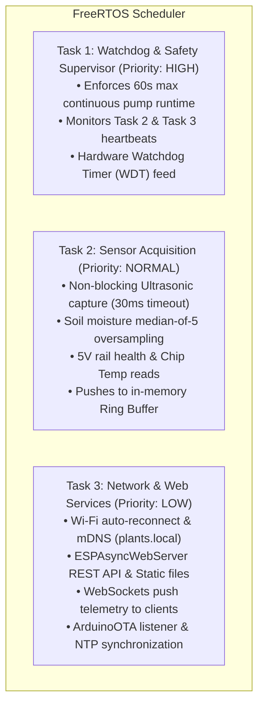

# Plant Monitor ESP32-C3: Project Specification & Architecture

## 1. Executive Summary & Objective

The **Plant Monitor ESP32-C3** project is the next-generation evolution of the original `plant-p2` system (previously built on Raspberry Pi Pico W with MicroPython). 

This project migrates the entire system to an **ESP32-C3 SuperMini** microcontroller programmed in **C++ using FreeRTOS** within the **PlatformIO** ecosystem. It resolves the core limitations of the previous implementation (MicroPython heap exhaustion, garbage collection stalls, SPI flash wear from synchronous file logging, sensor echo lockups, and hardcoded LAN IP links breaking external DDNS reverse proxies) while adding modern IoT capabilities like **mDNS (`http://plants.local`)**, **Over-The-Air (OTA) firmware updates**, and **hardware watchdog timer (WDT)** fail-safes.

---

## 2. Hardware Architecture & Electrical Specifications

### 2.1 Microcontroller: ESP32-C3 SuperMini
* **Architecture:** 32-bit single-core RISC-V processor clocked at 160 MHz.
* **Memory:** 400 KB SRAM, 4 MB SPI Flash.
* **Connectivity:** Integrated 2.4 GHz 802.11b/g/n Wi-Fi & Bluetooth 5 (LE).
* **Power:** 5V via USB-C or VIN pin; on-board 3.3V low-dropout regulator (LDO).
* **Onboard LED:** Blue LED tied to **GPIO 8 (Active LOW)**.
* **USB Interface:** Native USB Serial/JTAG on GPIO 18 (D-) and GPIO 19 (D+). *These pins are reserved exclusively for USB communication and are not broken out or used for sensors.*
* **Internal Sensors:** Built-in silicon temperature sensor read via `temperatureRead()`.

### 2.2 Breadboard Layout & Physical Geometry
* **Board Form Factor:** Compact quarter-size breadboard (15 columns, numbered 1 to 15; rows A–E on bottom half, rows F–J on top half).
* **Power Rails:** Dual power rails:
  * **Top Power Rails:** +5V (VBUS / USB power source) and GND.
  * **Bottom Power Rails:** +3.3V (regulated out from ESP32 3V3 pin) and GND (bridged to Top GND).
* **ESP32-C3 SuperMini Placement:**
  * Straddles the center divider across **Columns 1 to 8**.
  * **Top Header (Pins 5V, GND, 3V3, G0, G1, G2, G3, G4):** Inserted into **Row F**.
  * **Bottom Header (Pins G5, G6, G7, G8, G9, G10, G20, G21):** Inserted into **Row B**.
  * *Row A (bottom) and Row J (top) remain completely open for terminal block insertion.*

### 2.3 Terminal Blocks (5.08 mm Pitch / 0.2" Spacing)
All terminal blocks are mounted with screw openings facing **100% OUTWARDS** off the edges of the breadboard:
* **TB1 (4-pin, HC-SR04 Ultrasonic Sensor):** Located on **Row J** (Top edge) spanning **Columns 9, 11, 13, 15** (facing **UPWARDS** off top edge).
  * Pin 1 (Col 9): `+5V` (Top 5V Rail)
  * Pin 2 (Col 11): `TRIG` (jumper to Col 7 Top / GPIO 3)
  * Pin 3 (Col 13): `ECHO` (connects to 1k/2k voltage divider input)
  * Pin 4 (Col 15): `GND` (Top GND Rail)
* **TB2 (3-pin, Capacitive Soil Moisture Sensor v1.2):** Located on **Row F** (Top half inner edge) spanning **Columns 10, 12, 14** (facing **DOWNWARDS** into open center trench).
  * Pin 1 (Col 10): `VCC` (jumper to Col 6 Top / GPIO 2 for duty-cycled 3.3V switched power)
  * Pin 2 (Col 12): `AOUT` (jumper to Col 5 Top / GPIO 1)
  * Pin 3 (Col 14): `GND` (jumper to Top GND Rail; C2 100nF across Col 12 & 14)
* **TB3 (2-pin, 5V Submersible Pump Motor):** Located on **Row A** (Bottom edge) spanning **Columns 13, 15** (facing **DOWNWARDS** off bottom edge).
  * Pin 1 (Col 13): `Drain (-)` (Directly connects to MOSFET Drain via Column 13 breadboard trace)
  * Pin 2 (Col 15): `+5V (+)` (Jumper to +5V Rail)

### 2.4 Complete Pin & Component Mapping

| ESP32-C3 Pin | Header Location | Connected Component | Function & Conditioning |
| :--- | :--- | :--- | :--- |
| **GPIO 0** | Col 4 Top (Row G) | 5V Supply Voltage Monitor | ADC1_CH0 via 10kΩ/10kΩ divider (R1/R2) + 100nF filter cap (C1) |
| **GPIO 1** | Col 5 Top (Row G) | Capacitive Soil Sensor | ADC1_CH1 connected directly to TB2 Pin 2 (`AOUT`) |
| **GPIO 2** | Col 6 Top (Row G) | Switched Soil Sensor VCC | Digital OUT connected to TB2 Pin 1 (`VCC`). Duty-cycled 3.3V power |
| **GPIO 3** | Col 7 Top (Row G) | Ultrasonic Sensor `TRIG` | Digital output trigger pulse (10 µs pulse) |
| **GPIO 4** | Col 8 Top (Row G) | Ultrasonic Sensor `ECHO` | Digital input via 1kΩ/2kΩ divider (R3/R4) stepping 5V down to 3.3V |
| **GPIO 7** | Col 6 Bottom (Row A) | Pump MOSFET Gate | Digital output to FQP30N06L Gate via 1kΩ resistor (R5 into Col 12) + 100kΩ pull-down (R6) |
| **GPIO 8** | Internal / Onboard | System Status LED | Active LOW blue LED (breathing: idle, blinking: pump, flashing: error) |
| **ADC / Int** | Internal Silicon | Chip Temperature | Read via `temperatureRead()` core function |

#### Discrete Components:
* **R1 & R2 (10 kΩ each):** 5V rail voltage divider (5V $\rightarrow$ 2.5V, safe for 3.3V ADC).
* **C1 (100 nF ceramic):** Filter capacitor on GPIO 0 to eliminate ADC sampling ripple.
* **R3 (1 kΩ) & R4 (2 kΩ):** 5V-to-3.3V logic level divider for HC-SR04 ECHO pulse.
* **C2 (100 nF ceramic):** High-frequency RF decoupling filter directly across Soil AOUT and GND.
* **R5 (1 kΩ):** Gate damping resistor (Col 6 Row A to Col 12 Row C) protecting GPIO 7 from inrush capacitance and ringing.
* **R6 (100 kΩ):** Gate pull-down (Col 12 Row D to GND) ensuring pump stays completely OFF during boot and reset.
* **Q1 (FQP30N06L Logic-Level N-MOSFET, TO-220):** Low-side switch controlling 5V pump motor across 3 adjacent breadboard holes (Gate: Col 12, Drain: Col 13, Source: Col 14). Threshold $V_{GS(th)} = 1.0\text{–}2.5\text{V}$, $R_{DS(on)} = 0.045\,\Omega$ max at 5V ($< 0.05\,\Omega$ at 3.3V gate drive), $V_{DSS} = 60\text{V}$, $I_D = 32\text{A}$. Standard 0.1" (2.54mm) pin pitch drops straight into adjacent Cols 12, 13, 14 with zero lead bending (Pin 1 = Gate in Col 12, Pin 2 = Drain in Col 13, Pin 3 = Source in Col 14).
* **D1 (1N5819 Schottky Diode):** Flyback protection diode across TB3 (Cathode to +5V Col 15, Anode to Drain Col 13).
* **C3 (100 µF electrolytic):** Bulk power reservoir across +5V and GND to suppress motor startup dips (can also use 470 µF if available).

### 2.5 Permanent Soldered Perfboard Layout (18 Rows R $\to$ A Descending × 24 Columns 1–24)
For a permanent soldered build in an enclosure, an **18-row by 24-column 0.1" (2.54 mm) pitch through-hole perfboard** layout is fully designed and documented:
* **Board Dimensions:** 18 Rows descending vertically from **Row R (Top Edge)** to **Row A (Bottom Edge)** $\times$ 24 Columns ($1 \dots 24$, horizontal), 432 electrically isolated plated donut pads.
* **Isolated Pads Rule:** Perfboard holes have **no internal traces**. Every connection is explicitly made via bare solid bus wires, component lead bends, solder bridges, or insulated hookup jumpers.
* **Microcontroller Mounting:** 2× 1×8 female header sockets mounted across Columns 3–10 in **Row J** (Top Header) and **Row D** (Bottom Header) with standard 0.600" DIP pitch (6 rows).
* **USB-C Clearance:** USB-C connector faces **LEFT** into Columns 1–2, allowing flush cable connection with zero board interference.
* **Outward Sensor Terminals (Top Edge / Row Q):**
  * **TB2 (3-Pin Soil):** Row Q, Cols 7 (AOUT / Data), 9 (Switched VCC), 11 (GND); wire entries face **UPWARDS** off Row R. Pinout routes straight/parallel down into ESP32 GPIO 1 (J7) and GPIO 2 (J8) with **zero wire crossovers**.
  * **TB1 (4-Pin Ultrasonic):** Row Q, Cols 15 (5V), 17 (TRIG), 19 (ECHO), 21 (GND); wire entries face **UPWARDS** off Row R.
  * Spacer between TB2 and TB1: Cols 12–14 (7.62 mm spacing for unobstructed screwdriver access).
* **Supply Monitor Divider (Row K & L Zero-Crossing):**
  * **R1 (10kΩ):** Vertically spans N6 (+5V bus) to K6 (Divider Node).
  * **R2 (10kΩ):** Runs horizontally along Row K from K6 (Node) to K4 (GND). Solder bridged at K4 $\to$ J4 (ESP32 GND) and K6 $\to$ J6 (GPIO 0 ADC).
  * **C1 (100nF):** Ceramic filter with left leg in L4 (GND) and right leg in K6 (Node). Avoids crowding hole K4; directly grounded via Col 4 vertical bridge L4 $\to$ K4 $\to$ J4, and node directly bridged K6 $\to$ J6!
* **Outward Pump Terminal (Bottom Edge / Row B):**
  * **TB3 (2-Pin Pump):** Row B, Cols 13 (Drain -), 15 (+5V); wire entries face **DOWNWARDS** off Row A. Dedicated holes, completely separated from flyback diode D1.
* **Actuators & Direct Solder Bridges (Separated D1 & TB3):**
  * **Q1 (FQP30N06L TO-220 MOSFET):** Row C, Cols 12 (Gate), 13 (Drain), 14 (Source).
  * **D1 (1N5819 Schottky Diode):** Row E, Cols 13 (Anode) to 15 (Cathode). Cathode silver stripe faces Col 15 (+5V). Right side positioned at E15.
  * **Direct Underside Solder Bridges:** 
    * 4-pad bridge along Col 13: **E13 (Anode) $\to$ D13 $\to$ C13 (Q1 Drain) $\to$ B13 (TB3 Pin 1 Drain)**.
    * 4-pad bridge along Col 14: **D14 $\to$ C14 (Q1 Source) $\to$ B14 $\to$ A14 (Row A GND)**, fed directly from Row P GND bus via straight insulated wire from **P14 to D14**.
    * 4-pad bridge / lead bend along Col 15: **E15 (D1 Cathode) $\to$ D15 $\to$ C15 $\to$ B15 (TB3 Pin 2 +5V)**, fed directly from Row N +5V bus via straight insulated wire from **N15 to E15**.
    * Creates three symmetrical, parallel vertical tracks along Columns 13, 14, and 15 with zero diagonal cross-board wiring!
  * **Gate Drive:** R5 (1kΩ damping) across C8 $\to$ C11, bridged C11 $\to$ C12 to Gate; R6 (100kΩ pull-down) from C12 down to A12.
  * **C3 (100µF Bulk Capacitor):** Row L, Cols 3 (+) to 4 (-), directly joined between VCC (+5V at J3) and GND (J4) via vertical solder bridges L3 $\to$ K3 $\to$ J3 and M4 $\to$ L4 $\to$ K4 $\to$ J4.
* **Ground Distribution Architecture:**
  * **Sensor GND (Row P):** Bare bus wire along Row P (Cols 11–21) providing an ultra-quiet ground reference for capacitive soil sensor (GPIO 1) and ultrasonic echo divider (GPIO 4), fed directly from Col 4 GND track (M4) via top wires W3a (`M4 → P4`) and W3b (`P4 → P11`). Leaving P5–P10 open enables clean vertical signal routing down Column 7.
  * **Power / Motor GND (Row A):** Solder bridge or bus wire along Row A (Cols 12–14) sinking high-current pump transients from Q1 Source (C14) and R6 pull-down (A12) via the Col 14 ground bridge.
  * **Ground Feed:** Straight vertical 24 AWG insulated wire from Row P at **P14 down to D14**, joining into the 4-pad solder bridge down to A14. Eliminates diagonal cross-board star wiring!
* **Anti-Short Dual-Layer Wiring Architecture (Optimized 10 Top / 18 Bottom):**
  * **Physical Dielectric Isolation:** Crossing insulated jumper wires across bare bus rails on the solder side creates severe short hazards. To guarantee **100% short-free operation**, the design physically isolates wiring into two separate layers through the 1.6 mm FR4 fiberglass core:
    * **Bottom Layer (Solder Side — 18 Rigid Connections):** Strictly limited to bare bus rails (B1 Row P GND P11-P21, B2 Row N +5V N3-N15, B3 Row A GND A12-A14) and direct adjacent solder bridges (B4 K6-J6 Node, B5 Col 3 5V Track N3-M3-L3-K3-J3, B6 Col 4 GND Track M4-L4-K4-J4, B7 J7-K7 Soil ADC Bridge, B8 J8-K8 Soil VCC Bridge, B9 J9-K9 Ultrasonic TRIG Bridge, B10 J10-K10 Ultrasonic ECHO Bridge, B11 Col 13 Pump Drain, B12 Col 14 Pump GND, B13 Col 15 Pump 5V, B14 C11-C12 Gate Resistor, B15 D8-C8 Gate Drive, B16 Col 7 Soil Data Track Q7-P7-O7, B17 Col 11 Soil GND Tie Q11-P11-O11, B18 Col 21 Ultrasonic GND Q21-P21). **Zero crossing wires on the bottom!**
    * **Top Layer (Component Side — 10 Insulated Wires):** All rail-crossing and section-linking connections run as elevated, insulated hookup wires above the components (W1 P14→D14 GND Feed, W2 N15→E15 5V Pump Feed, W3a M4→P4 Col 4 GND Jump, W3b P4→P11 Row P GND Feed, W4 N15→Q15 TB1 5V, W5 Q19→O19 TB1 Echo, W6 O7→K7 Soil Data, W7 Q9→K8 Soil VCC, W8 K9→Q17 Trig, W9 O17→K10 Echo 3.3V).
    * **Row K Breakout Architecture:** All 5 microcontroller signal jumpers (Node, Soil Data, Soil VCC, TRIG, ECHO) terminate cleanly into Row K through-holes (`K6`, `K7`, `K8`, `K9`, `K10`), bridged directly on the bottom to ESP32 header pins (`J6-K6`, `J7-K7`, `J8-K8`, `J9-K9`, `J10-K10`). This leaves the entire female socket header on Row J completely free of top-side soldered wires.
* **Full Assembly Guide & Visualizer:**
  * Guide: [`perfboard_circuit_guide.md`](file:///Users/robertlongbottom/dev/plant-esp32/perfboard_circuit_guide.md)
  * Interactive SVG Visualizer: [`perfboard_diagram.html`](file:///Users/robertlongbottom/dev/plant-esp32/perfboard_diagram.html) (Top, Bottom Mirrored, and X-Ray composite views with independent layer toggle checkboxes for Top Insulated Wires, Top Components, Bottom Solder Bridges, Bottom Bus Rails, pad inspection, and fluid wide-screen zoom).

---

## 3. Firmware Architecture & FreeRTOS Concurrency

### 3.1 Concurrency Model
The firmware runs on FreeRTOS with three dedicated, preemptive tasks:



### 3.2 In-Memory Ring Buffer & Storage Strategy
* **Zero Flash Wear:** Sensor readings and failure logs are kept in a circular ring buffer in RAM (`std::deque` or fixed array). 
* **Capacity:** 100 recent historical sensor points + 50 recent diagnostic events.
* **LittleFS File System:** Flash memory is strictly reserved for:
  1. Static web assets (`index.html`, `app.js`, `style.css`).
  2. Persistent user configuration (`config.json`), updated only when the user explicitly saves changes from the web dashboard.

---

## 4. Networking, mDNS & Remote Access

### 4.1 Zero-Configuration mDNS
* **Hostname:** Configurable via `config.json` (defaults to `plants`).
* **mDNS Domain:** `http://plants.local`.
* **Behavior:** Eliminates the need for static IP configuration or DHCP reservations. Any device on the local network (macOS, iOS, Windows, Linux, Android) resolves `plants.local` to the dynamic IP assigned to the ESP32.

### 4.2 Reverse Proxy & DDNS Compatibility
* **Origin Agnostic:** All web UI assets call strictly relative endpoints (e.g. `fetch('/api/sensor-log?n=10')`).
* **Reverse Proxy Support:** Allows external access through reverse proxies (e.g., `https://plants.franticbrain.ddnsfree.com`) without hardcoded private LAN IP leaks or broken links.
* **CORS Support:** Permissive CORS headers enabled on all `/api/*` endpoints for headless or third-party dashboard integrations.

### 4.3 Over-The-Air (OTA) Updates
* Embedded `ArduinoOTA` listener allows pushing updated compiled binaries directly over Wi-Fi from PlatformIO without physical USB connection.
* Web-based fallback OTA endpoint (`POST /update`) for manual `.bin` firmware file uploads via the browser.

---

## 5. Sensor Logic & Robustness Improvements

### 5.1 HC-SR04 Hardware Timer & Un-Sticking Routine
* **30 ms Hard Timeout:** Ultrasonic sound travels at ~34.3 cm/ms. Round-trip for 5.14 meters is 30 ms. In our plant reservoir (< 50 cm), an echo taking longer than 30 ms is physically impossible.
* **Non-Blocking Measurement:** Pulse duration is measured using `esp_timer_get_time()`. If 30 ms elapses without the ECHO pin returning `LOW`, the function aborts immediately with `TIMEOUT_ERROR`.
* **Software Kick (Un-stitching clone sensors):** If the sensor latches HIGH, the ESP32 reconfigures GPIO 4 as an output, drives it `LOW` for 10 µs to clear the sensor's latch, switches it back to input, and enforces a 30 ms acoustic damping quiet time.

### 5.2 Factory eFuse Calibrated ADC Reads
* Utilizes ESP-IDF `esp_adc_cal` to read factory-calibrated curves burned into eFuse.
* **GPIO 0 (5V Rail):** Monitored continuously. Records supply rail voltage before and during pump operation to detect weak power adapters or brownouts.
* **GPIO 1 (Soil Moisture):** 5-sample median filter with 10 ms spacing to reject power line noise and sensor ripple.

---

## 6. Pump Safety & Plant Protection System

To prevent flooding or hardware burnout, the system implements multi-tiered safety constraints:

1. **Hardware Watchdog Timer (WDT):** 5-second timeout. If the FreeRTOS scheduler or main tasks hang while the pump is active, the WDT triggers a hard reboot, instantly bringing GPIO 7 `LOW` via the 100kΩ pull-down resistor (R6).
2. **Maximum Continuous Pump Runtime:** Hard cutoff after 60 seconds (configurable).
3. **Minimum Cycle Cooldown:** Enforces a minimum delay (default 300 seconds / 5 minutes) between consecutive watering cycles to allow moisture absorption.
4. **Daily Watering Limit:** Enforces a maximum cumulative watering time per calendar day (default 60 seconds / day), resetting at midnight via NTP.
5. **Night-Watering Lockout:** Inhibit automated watering between 10:00 PM and 9:00 AM (configurable).
6. **Dry Tank Cutoff:** If the water level is below 2.0 cm, automated and manual watering are blocked to prevent running the pump dry.

---

## 7. REST API & WebSockets Contract

The firmware preserves 100% backward compatibility with `plant-p2`:

| Endpoint | Method | Description |
| :--- | :--- | :--- |
| `/api/status` | `GET` | Returns live sensor values (soil %, water level cm, supply voltage V, chip temp °C), pump state, and uptime. |
| `/api/sensor-log` | `GET` | Returns last $N$ sensor readings in JSON array format (e.g. `?n=10`, `?n=50`). |
| `/api/config` | `GET` | Returns the current JSON configuration. |
| `/api/config` | `POST` | Updates and persists configuration to LittleFS. |
| `/api/water` | `POST` | Triggers a manual watering cycle (accepts `{ "duration": 10 }`). |
| `/api/sensor/health` | `GET` | Returns diagnostic metrics (preventive resets count, ADC calibration status, Wi-Fi RSSI). |
| `/api/sensor/ultrasonic/reset` | `POST` | Forces an immediate hardware pin clear and ultrasonic sensor recalibration. |
| `/ws` | `WebSocket` | Real-time bi-directional telemetry and event streaming. |

---

## 8. Configuration Schema (`config.json`)

```json
{
  "system": {
    "hostname": "plants",
    "timezone": "Asia/Singapore",
    "gmt_offset": 8,
    "ntp_servers": [
      "time.google.com",
      "pool.ntp.org",
      "time.nist.gov"
    ],
    "monitoring_interval_sec": 60
  },
  "gauges": {
    "soil_moisture": {
      "trigger_threshold": 40,
      "dry_adc": 2800,
      "wet_adc": 1100
    },
    "water_level": {
      "tank_height_cm": 30.0,
      "sensor_offset_cm": 3.0,
      "min_safe_level_cm": 2.0
    },
    "voltage": {
      "min_warning": 4.5,
      "max_warning": 5.5
    }
  },
  "timing": {
    "startup_delay_sec": 30,
    "check_interval_sec": 3600,
    "sensor_read_interval_sec": 600,
    "automated_water_duration_sec": 20,
    "manual_water_duration_sec": 10
  },
  "safety": {
    "max_continuous_pump_sec": 60,
    "min_time_between_cycles_sec": 300,
    "daily_watering_limit": {
      "enabled": true,
      "max_seconds_per_day": 60
    },
    "night_watering_protection": {
      "enabled": true,
      "start_hour": 22,
      "end_hour": 9
    }
  }
}
```

---

## 9. PlatformIO Project Structure

```text
plant-esp32/
├── platformio.ini               # PlatformIO environment, board & library dependencies
├── PROJECT.md                   # Complete specification and requirements reference (this file)
├── breadboard_circuit_guide.md  # Step-by-step physical breadboard wiring guide (15-column)
├── circuit_diagram.html         # Interactive breadboard SVG visualizer & BOM
├── perfboard_circuit_guide.md   # Permanent 18x24 soldered perfboard assembly & wiring guide
├── perfboard_diagram.html       # Interactive perfboard SVG visualizer (Top, Bottom, X-Ray)
├── include/
│   ├── config_schema.h          # Configuration structures and defaults
│   ├── pin_definitions.h        # Board pinout mapping (GPIO 0, 1, 3, 4, 7, 8)
│   ├── ring_buffer.h            # In-memory circular telemetry log buffer
│   ├── safety_manager.h         # Cooldown, daily cap, night lockout, and pump limits
│   └── sensor_manager.h         # Non-blocking HC-SR04, ADC calibration, soil & voltage
├── src/
│   ├── main.cpp                 # FreeRTOS tasks setup, core initialization
│   ├── safety_manager.cpp       # Pump watchdog & safety enforcement
│   ├── sensor_manager.cpp       # HC-SR04 timer capture & ADC reading routines
│   └── web_server.cpp           # ESPAsyncWebServer routes, WebSockets, mDNS, OTA
└── data/                        # LittleFS filesystem partition
    ├── config.json              # Default user settings
    ├── index.html               # Web dashboard interface
    ├── app.js                   # Client-side JavaScript with relative API routing
    └── style.css                # Responsive UI styling
```

---

## 10. Low-Power Management & Idle Optimization

### 10.1 Strategy 1: Always-Online Low-Power (Implemented)
* **Wi-Fi Modem Sleep (`WIFI_PS_MIN_MODEM`):** Radio powers down between 802.11 AP DTIM beacons (~100–300 ms). Wakes within microseconds upon incoming TCP/HTTP packets. Zero latency perceived by browser clients.
* **CPU Downclocking:** Microcontroller clocked at 80 MHz (reduced from 160 MHz default).
* **Power Savings:** Reduces idle draw from ~110 mA (~0.55 W) down to ~20 mA (~0.10 W) — an ~82% reduction with zero hardware changes.

### 10.2 Strategy 2: Sensor Power Gating (Under Discussion)
* **Capacitive Soil Sensor Duty-Cycling:** Capacitive sensor draws 6–8 mA continuously at 3.3V. Powering it via an unassigned GPIO (e.g., GPIO 2 on Col 6 Top) allows energizing the sensor only for the 50 ms required during active reading cycles.
* **Benefits:** Eliminates 6–8 mA continuous quiescent draw and stops continuous DC bias in soil, drastically reducing galvanic corrosion and sensor drift.
