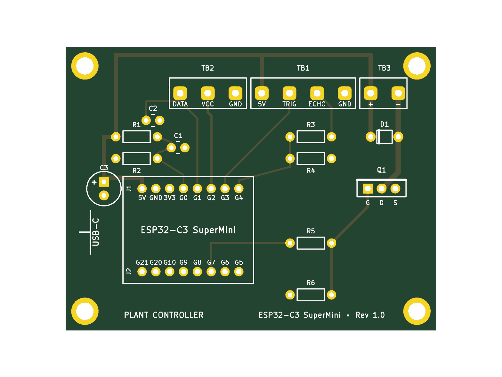
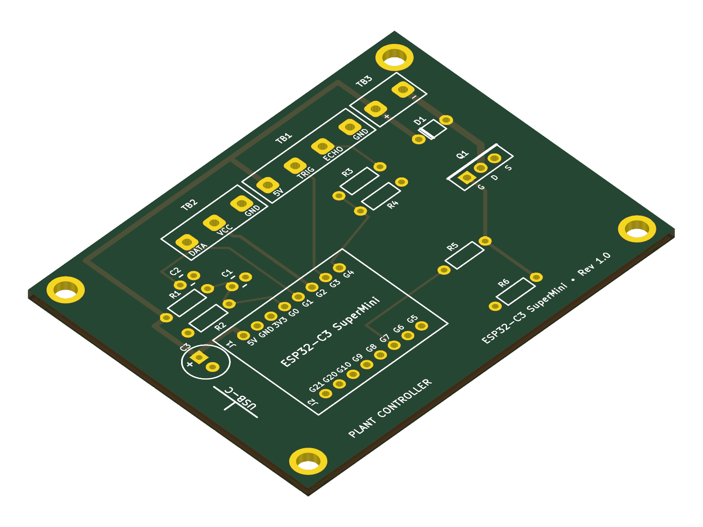
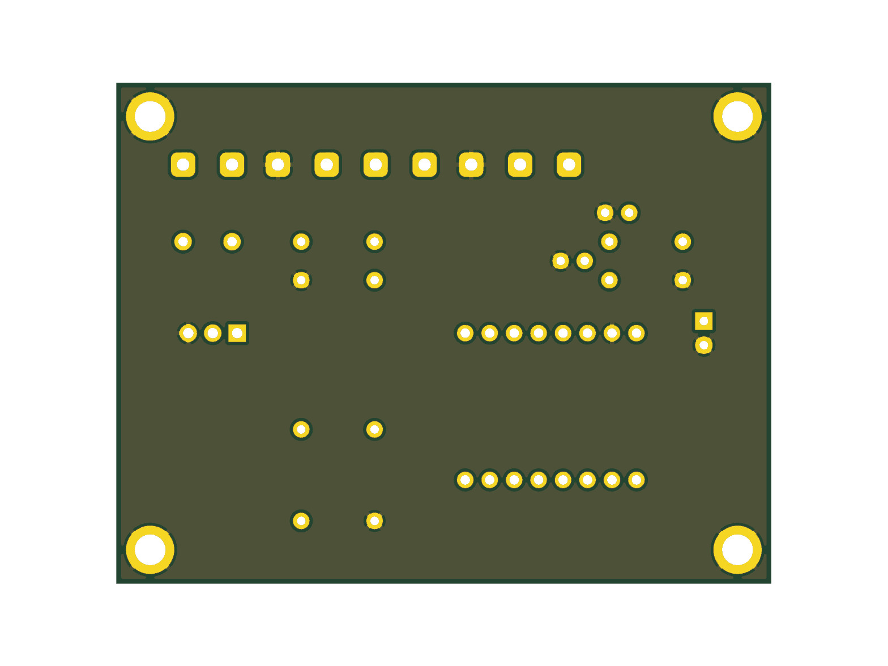

# Plant ESP32 Controller — Custom PCB Fabrication Package

This directory contains the production-ready KiCad 8/10 project, fabrication files (Gerbers & Drill), 3D visual renders, and ordering instructions for the **Plant ESP32 Automated Watering & Telemetry System**.

---

## 3D Board Previews

| Top View (Components & Silkscreen) | Isometric 3D View |
| :---: | :---: |
|  |  |

| Bottom View (Ground Plane Pour) |
| :---: |
|  |

---

## PCB Specifications

| Parameter | Specification | Fabricator Default? |
| :--- | :--- | :--- |
| **Dimensions** | **68.0 mm × 52.0 mm** | Custom (auto-detected from Edge.Cuts) |
| **Layer Count** | **2 Layers** (Top: Signal & Power Bus, Bottom: Solid Ground Plane) | Yes |
| **Board Thickness** | **1.6 mm** | Yes (Standard) |
| **Base Material** | FR-4 Standard (Tg 130–140°C) | Yes |
| **Copper Weight** | **1 oz** (35 µm) | Yes |
| **Surface Finish** | **HASL Lead-Free** (or Lead-Free OSP / ENIG) | Recommended: HASL Lead-Free |
| **Solder Mask** | Any color (Green, Matte Black, Blue, Purple) | Yes |
| **Silkscreen** | White | Yes |
| **Mounting Holes** | **4× M3** (3.2 mm drill, 5.0 mm annular ring, grounded) | Yes |
| **Design Rule Check** | **0 DRC Violations • 0 Unconnected Nets** | 100% Clean |

---

## Bill of Materials (BOM) — 100% Through-Hole (THT)

All components use standard through-hole footprints so hand-soldering requires only a standard soldering iron and wire cutters:

| Designator | Description / Value | Footprint / Pitch | Recommended Part / Notes |
| :--- | :--- | :--- | :--- |
| **ESP32** | ESP32-C3 SuperMini module | 2× 1x8 Female Pin Header (2.54 mm pitch, 15.24 mm spacing) | ESP32-C3 SuperMini (or standard 2.54 mm female headers) |
| **TB1** | 4-Pin Screw Terminal Block | 5.08 mm pitch (XY306 / KF301) | Ultrasonic Sensor (5V, TRIG, ECHO, GND) |
| **TB2** | 3-Pin Screw Terminal Block | 5.08 mm pitch (XY306 / KF301) | Soil Moisture Sensor (DATA, VCC, GND) |
| **TB3** | 2-Pin Screw Terminal Block | 5.08 mm pitch (XY306 / KF301) | 5V Submersible Pump (+5V, Drain -) |
| **Q1** | N-Channel Power MOSFET | TO-220-3 Vertical | **FQP30N06L** / IRLZ44N (Logic-Level, $V_{GS(th)} \le 2.5\text{V}$) |
| **D1** | Schottky Flyback Diode | DO-41 Horizontal (7.62 mm pitch) | **1N5819** (1A 40V Schottky) |
| **R1, R2** | 10 kΩ Resistor (1/4W) | Axial DIN0207 (7.62 mm pitch) | Supply Voltage Divider ($V_{in} \to$ GPIO0) |
| **R3** | 1 kΩ Resistor (1/4W) | Axial DIN0207 (7.62 mm pitch) | Echo Divider High-Side (Echo 5V $\to$ GPIO4) |
| **R4** | 2 kΩ Resistor (1/4W) | Axial DIN0207 (7.62 mm pitch) | Echo Divider Low-Side (GPIO4 $\to$ GND) |
| **R5** | 1 kΩ Resistor (1/4W) | Axial DIN0207 (7.62 mm pitch) | Gate In-Rush Current Limiter (GPIO7 $\to$ Gate) |
| **R6** | 100 kΩ Resistor (1/4W) | Axial DIN0207 (7.62 mm pitch) | Gate Pull-Down Bleeder (Gate $\to$ GND) |
| **C1** | 100 nF (0.1 µF) Ceramic Capacitor | Disc 2.5 mm pitch | ADC Smoothing Filter |
| **C2** | 100 nF (0.1 µF) Ceramic Capacitor | Disc 2.5 mm pitch | Soil Sensor Analog RF Noise Filter |
| **C3** | 100 µF Electrolytic Capacitor (16V–25V) | Radial D6.3 mm, 2.5 mm pitch | 5V Power Rail Transient Bulk Decoupling |
| **H1–H4** | 4× M3 Standoffs / Screws | 3.2 mm hole | M3 nylon or brass PCB standoffs (10–15 mm) |

---

## Terminal Block Wiring Reference

The silkscreen on the top of the board is labeled for wiring:

```
[ Top Edge of PCB ]
  TB2 (Soil Moisture)    TB1 (Ultrasonic Sensor)     TB3 (Pump)
   [DATA] [VCC] [GND]     [5V] [TRIG] [ECHO] [GND]    [ + ] [ - ]
```

- **TB2 (Soil Sensor)**:
  - `DATA` $\to$ Sensor Analog Out (Yellow wire)
  - `VCC` $\to$ Sensor VCC (GPIO2 switched power, Red wire)
  - `GND` $\to$ Sensor GND (Black wire)
- **TB1 (Ultrasonic Sensor - HC-SR04 / RCWL-1601)**:
  - `5V` $\to$ Sensor VCC (Red wire)
  - `TRIG` $\to$ Sensor Trig (GPIO3, Yellow wire)
  - `ECHO` $\to$ Sensor Echo (Blue wire, protected by internal 1k/2k voltage divider)
  - `GND` $\to$ Sensor GND (Black wire)
- **TB3 (Submersible Water Pump)**:
  - `+` $\to$ Pump Positive lead (Red wire, connects to +5V)
  - `-` $\to$ Pump Negative lead (Black wire, switched to GND via MOSFET Drain)

---

## How to Order the PCB

### Ordering via JLCPCB (Recommended — 2 to 4 Day Shipping to Singapore / SEA)
1. Go to **[jlcpcb.com](https://jlcpcb.com/)** and click **"Order Now"** or **"Instant Quote"**.
2. Click **"Add Gerber file"** and upload:
   ```
   pcb/plant-esp32_gerbers.zip
   ```
3. JLCPCB will automatically extract the package, detect the dimensions (**68 mm × 52 mm**), and render a live 2D/3D board preview.
4. Verify standard options (usually selected by default):
   - **Base Material**: FR-4
   - **Layers**: 2
   - **Dimensions**: 68 mm × 52 mm
   - **PCB Qty**: 5 (minimum order)
   - **Thickness**: 1.6 mm
   - **PCB Color**: Choose your favorite (Green is default, Matte Black, Blue, or Purple look great)
   - **Surface Finish**: **HASL Lead-Free** (recommended for household/potted plant use)
   - **Copper Weight**: 1 oz
5. Cost: Typically **US \$2.00** for 5 boards (+ ~\$3–\$5 courier shipping to Singapore via SF Express / DHL / standard air).

### Ordering via PCBWay
1. Go to **[pcbway.com](https://pcbway.com/)**.
2. Select **Quick-order PCB**, enter `Length: 68 mm`, `Width: 52 mm`, `Quantity: 5`, `Layers: 2`.
3. Upload `pcb/plant-esp32_gerbers.zip` and submit.

### Ordering via Shopee / Lazada / AliExpress Custom PCB Vendors
1. In Shopee SG / Lazada / AliExpress, search for `"custom PCB fabrication service"` or `"PCB prototype"`.
2. Many sellers ask you to send the Gerber zip file via chat or email.
3. Send `pcb/plant-esp32_gerbers.zip`. They will quote based on 68 mm × 52 mm 2-layer specs.

---

## Assembly / Soldering Guide

Soldering from the lowest profile components to the tallest makes assembly simple and keeps parts flat against the board:

1. **Step 1: Resistors (R1, R2, R3, R4, R5, R6)**
   - Bend leads at 90°, insert from top side, splay leads slightly underneath, solder and clip leads.
   - Note: R1 & R2 are 10kΩ (Brown-Black-Orange). R3 & R5 are 1kΩ (Brown-Black-Red). R4 is 2kΩ (Red-Black-Red). R6 is 100kΩ (Brown-Black-Yellow).
2. **Step 2: Schottky Diode (D1)**
   - Align the **white cathode stripe** with the stripe shown on the silkscreen (facing the left / Pin 1 side).
3. **Step 3: Ceramic Capacitors (C1, C2)**
   - Insert C1 (100nF) and C2 (100nF). Ceramic disc capacitors are non-polarized.
4. **Step 4: ESP32 Pin Headers (J1, J2)**
   - Insert two 1×8 female socket strips. You can plug the ESP32 into the headers while soldering to ensure alignment.
5. **Step 5: MOSFET (Q1)**
   - Orient Q1 so the metal tab faces the top edge (as indicated by the thick silkscreen line).
6. **Step 6: Electrolytic Bulk Capacitor (C3)**
   - **Observe polarity**: Long lead is positive (+), striped side with "-" marks is negative (GND).
7. **Step 7: Screw Terminal Blocks (TB1, TB2, TB3)**
   - Insert with the wire entry openings facing outward towards the top edge of the board. Solder the heavy pins.
8. **Step 8: Stand-offs**
   - Fasten four M3 standoffs into the corner mounting holes H1–H4.

---

## Opening and Modifying in KiCad

To open this project locally:
1. Open KiCad 8 or KiCad 10.
2. Select **File $\to$ Open Project...** and choose:
   ```
   pcb/plant-esp32.kicad_pro
   ```
3. Double-click `plant-esp32.kicad_pcb` to view the routed layout.
4. All footprints and net connections are embedded self-contained inside the board file, requiring no external library installations.
