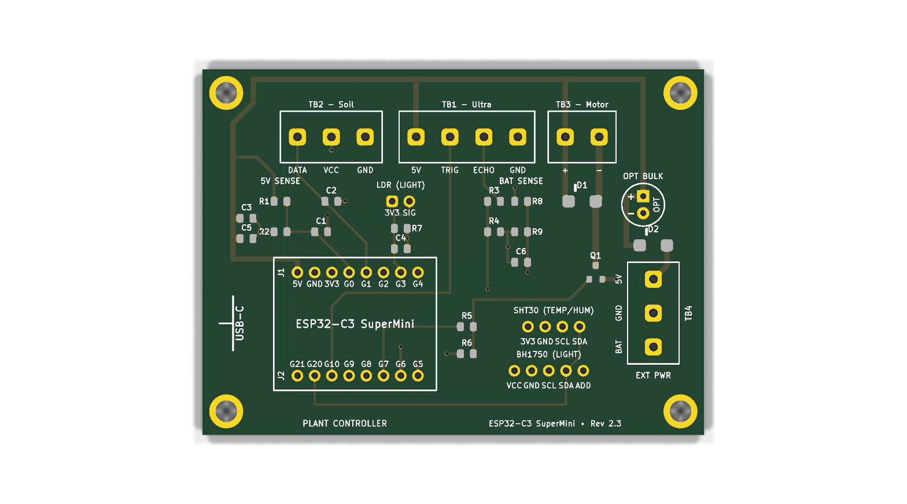
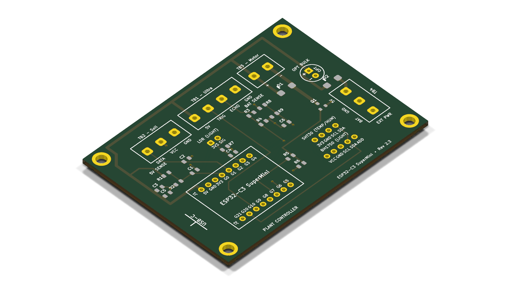
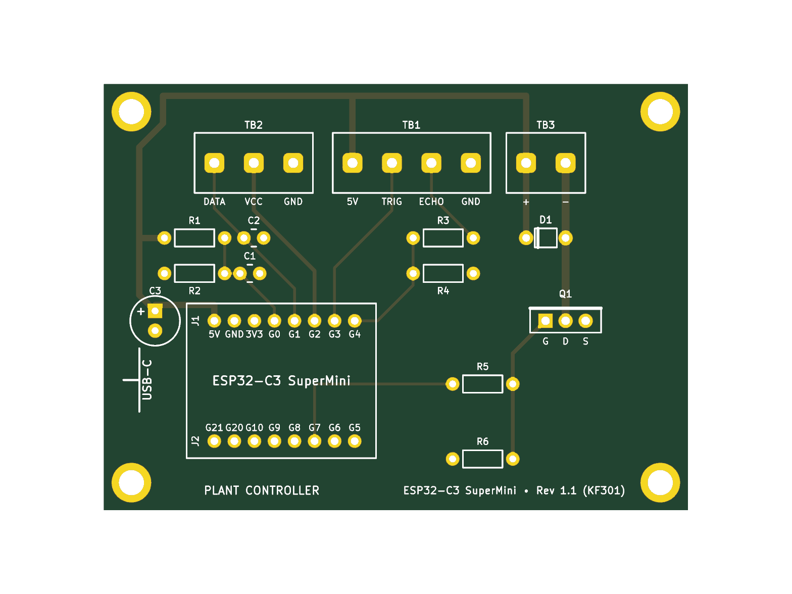

# Plant ESP32 Controller — Hardware & PCB Design Hub

This directory contains the complete circuit designs, fabrication archives, interactive prototyping visualizers, and documentation for the **Plant ESP32 Automated Watering & Telemetry System**.

The repository provides three production editions sharing the exact same mechanical footprint ($74.0 \times 54.0\,\text{mm}$), identical M3 mounting hole locations, and identical KF301 screw terminal positions:

---

## Hardware Editions Directory Structure

```
pcb/
├── smd/                            # Turnkey SMT / SuperMini Socket Edition (Rev 2.3)
│   ├── plant-esp32-smd.kicad_pcb    # KiCad PCB layout (0 DRC violations)
│   ├── plant-esp32-smd.kicad_sch    # Schematic netlist
│   ├── plant-esp32-smd_gerbers.zip  # Production Gerber & drill fabrication zip
│   ├── plant-esp32-smd_bom.csv      # JLCPCB SMT BOM (100% Basic Parts, $0 fees)
│   ├── plant-esp32-smd_cpl.csv      # Pick-and-place centroids
│   ├── generate_pcb_smd.py          # Python layout generator & DRC compiler
│   ├── plant-esp32-smd-top.png      # 3D render top view
│   └── README.md                    # Dedicated SMD BOM & JLCPCB ordering guide
│
├── esp32-onboard-smd/              # Fully Integrated Onboard ESP32-C3-WROOM-02 Edition
│   ├── plant-esp32-onboard.kicad_pcb # KiCad PCB layout (0 DRC violations)
│   ├── plant-esp32-onboard.kicad_sch # Complete KiCad schematic
│   ├── plant-esp32-onboard_gerbers.zip # Production Gerber & drill fabrication zip
│   ├── plant-esp32-onboard_bom.csv   # JLCPCB SMT BOM
│   ├── plant-esp32-onboard_cpl.csv   # Pick-and-place centroids
│   ├── build_onboard_pcb.py          # Python layout generator & precision router
│   ├── precision_router.py           # A* grid router for high-density routing
│   ├── plant-esp32-onboard-top.png   # 3D render top view
│   └── README.md                     # Dedicated Onboard Edition guide
│
├── hole-thru/                       # 100% Through-Hole Edition (Rev 2.0)
│   ├── plant-esp32.kicad_pcb        # KiCad PCB layout (0 DRC violations)
│   ├── plant-esp32.kicad_sch        # Schematic netlist
│   ├── plant-esp32_gerbers.zip      # Production Gerber & drill fabrication zip
│   ├── generate_pcb.py              # Python layout generator
│   ├── circuit_diagram.html         # Interactive breadboard SVG visualizer
│   ├── breadboard_circuit_guide.md  # Step-by-step breadboard assembly guide
│   ├── perfboard_diagram.html       # Interactive perfboard SVG visualizer
│   ├── perfboard_circuit_guide.md   # Step-by-step soldered perfboard guide
│   ├── pcb_render_top.png           # 3D render top view
│   ├── pcb_render_iso.png           # 3D render isometric view
│   ├── pcb_render_bottom.png        # 3D render bottom view
│   └── README.md                    # Dedicated through-hole assembly guide
│
└── README.md                        # Master hardware index (this file)
```

---

## Comparison: SMD vs. Through-Hole

| Feature | 🤖 Turnkey SMD Edition (`pcb/smd/`) | 🛠️ Through-Hole Edition (`pcb/hole-thru/`) |
| :--- | :--- | :--- |
| **Best For** | Automated JLCPCB factory assembly | DIY hand soldering & prototyping |
| **Assembly Effort** | **Minimal** — JLCPCB pre-solders all SMD parts | Full hand-soldering of all passives |
| **JLCPCB Feeder Fees** | **\$0.00** (100% Basic Library Parts) | N/A (Standard bare PCB fabrication) |
| **MOSFET** | AO3400A (SOT-23, 30V 5.7A, Low $R_{DS(on)}$) | FQP30N06L / IRLZ44N (TO-220-3) |
| **Flyback Diode** | SS34 (SMA / DO-214AC, 3A 40V Schottky) | 1N4001 (DO-41 axial) |
| **Solar / Battery Input** | **TB4** (KF301-3P) + **D2** (SS34 Anti-Backfeed Diode) | N/A (USB / 5V rail direct) |
| **Battery Monitoring** | **Dedicated Dual ADC** (5V Rail on G4 + 18650 on G0, 0 jumpers) | 5V Rail Divider only (210 µA drain) |
| **5V Power Decoupling** | **Hybrid**: 2× 10 µF Basic MLCCs + Radial `C_EXT` (DNP) | 100 µF Radial Electrolytic can |
| **Expansion Sockets** | **Included**: LDR divider, SHT30, BH1750 (DNP) | Standard core functionality |
| **Firmware Mapping** | Soil on **G3/G21**, LDR on **G1**, TRIG on **G7**, ECHO on **G20**, Bat on **G0**, 5V on **G4** | Soil Power on **GPIO 2**, TRIG on **GPIO 3**, ECHO on **GPIO 4** |
| **Canonical Pinout** | [LastMinuteEngineers Pinout Reference](https://lastminuteengineers.com/esp32-c3-super-mini-pinout-reference/) | [LastMinuteEngineers Pinout Reference](https://lastminuteengineers.com/esp32-c3-super-mini-pinout-reference/) |

---

## 3D Board Previews

### 🤖 Option 1: Turnkey SMD Edition with Expansion (Rev 2.3)
👉 **Full details and ordering guide:** [`pcb/smd/README.md`](smd/README.md)

| Top View (SMD) | Isometric 3D View (SMD) |
| :---: | :---: |
|  |  |

---

### 🛠️ Option 2: 100% Through-Hole Edition (Rev 2.0)
👉 **Full details and assembly guide:** [`pcb/hole-thru/README.md`](hole-thru/README.md)

| Top View (THT) | Isometric 3D View (THT) |
| :---: | :---: |
|  |  |

---

## Terminal Block Wiring Reference

### Top Edge Terminals (Both Editions)

```
[ Top Edge of PCB ]
  TB2 (Soil Moisture)          TB1 (Ultrasonic)           TB3 (Pump)
   [DATA] [VCC] [GND]       [5V] [TRIG] [ECHO] [GND]       [ + ] [ - ]
```

* **TB2 (Soil Sensor)**:
  * `DATA` $\to$ Sensor Analog Out (GPIO 3 on SMD edition / GPIO 1 on THT edition)
  * `VCC` $\to$ Sensor VCC (GPIO 21 on SMD edition / GPIO 2 on THT edition)
  * `GND` $\to$ Sensor GND
* **TB1 (Ultrasonic Sensor - HC-SR04 / RCWL-1601)**:
  * `5V` $\to$ Sensor VCC
  * `TRIG` $\to$ Sensor Trig (GPIO 7 on SMD edition / GPIO 3 on THT edition)
  * `ECHO` $\to$ Sensor Echo (GPIO 20 on SMD edition / GPIO 4 on THT edition via 1k/2k level-divider)
  * `GND` $\to$ Sensor GND
* **TB3 (Submersible Water Pump)**:
  * `+` $\to$ Pump Positive lead (connected to +5V)
  * `-` $\to$ Pump Negative lead (switched to GND via MOSFET Drain, Gate on GPIO 10)

### Right Edge Terminal (SMD Edition Only - Rev 2.3)

```
[ Right Edge of PCB ]
  TB4 (External Solar / Battery 18650 UPS Module)
   [EXT_5V] [GND] [BAT] (wire entry facing right)
```

* **TB4 (External Power & Battery)**:
  * `EXT_5V` (Pin 1) $\to$ Regulated +5V output from solar boost converter (protected by D2 anti-backfeed diode)
  * `GND` (Pin 2) $\to$ Common system ground
  * `BAT` (Pin 3) $\to$ Direct connection to 18650 Li-ion battery positive terminal (`BAT+`)
* **Dedicated Dual ADC Voltage Monitoring (No Jumpers!)**:
  * **GPIO 4 (`ADC1_CH4`)**: Dedicated 5V supply rail monitor via 100k/100k divider + 100nF
  * **GPIO 0 (`ADC1_CH0`)**: Dedicated 18650 battery monitor via 100k/100k divider + 100nF from TB4 Pin 3 (21 µA drain)
  * Both voltages sampled simultaneously in real-time firmware with zero selector headers or manual jumpers.
