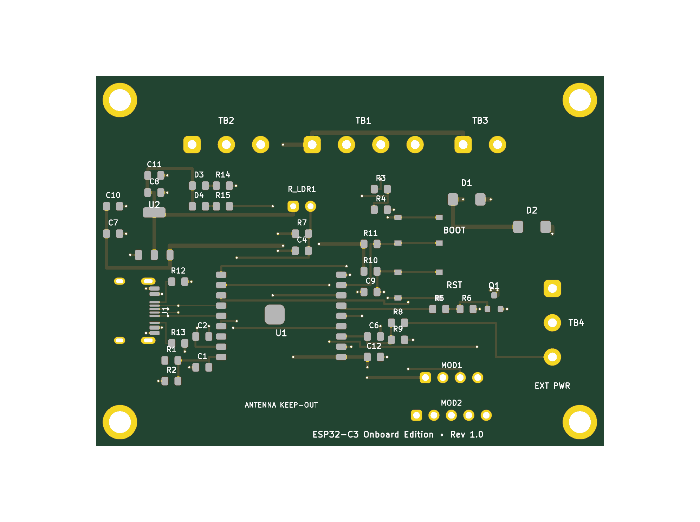
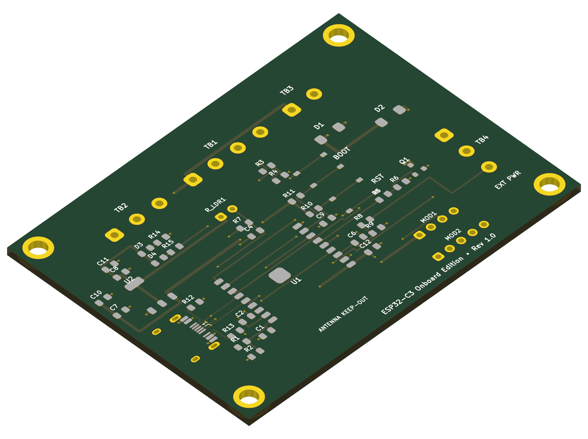
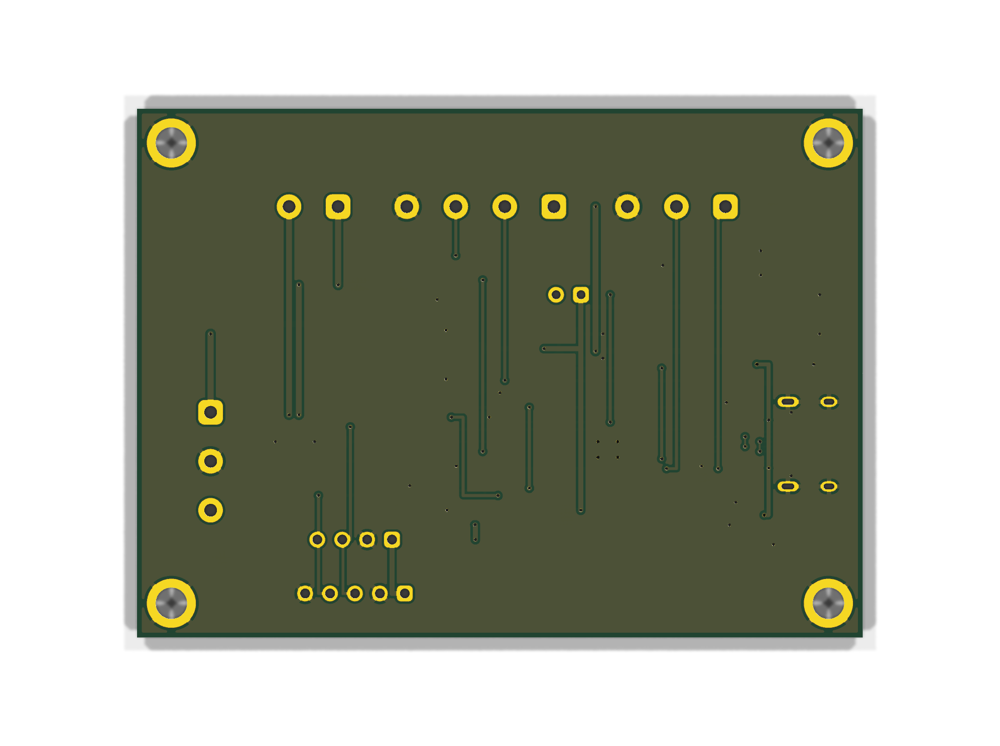

# Plant ESP32 Controller — Monolithic Onboard SMD Edition (Rev 1.0)

This directory contains the production files, Pick & Place centroid files (CPL), Bill of Materials (BOM), KiCad design source files, and 3D renders for the **Monolithic Onboard SMD Edition** of the Plant ESP32 watering controller.

Rather than mounting an ESP32-C3 SuperMini daughterboard via pin headers, this turnkey edition integrates the official **Espressif ESP32-C3-WROOM-02** Wi-Fi + BLE 5 module directly onto the PCB, complete with native USB-C, onboard AMS1117-3.3 power regulation, tactile RESET & BOOT buttons, status/power LEDs, and multi-stage filtering.

Optimized specifically for **JLCPCB SMT Assembly** using **100% Top-Side placement** and prioritizing JLCPCB Basic Parts to keep assembly setup fees to an absolute minimum ($9.00 total for only 3 extended part reels across the entire production run).

---

## 3D Previews & Interactive Diagram

| Top View (Integrated ESP32-C3 & SMT Components) | Isometric 3D View |
| :---: | :---: |
|  |  |

| Bottom View (Ground Plane & Solder Mask) |
| :---: |
|  |

👉 **Interactive SVG Circuit Diagram & Net Visualizer:** [`circuit_diagram_onboard.html`](circuit_diagram_onboard.html)

---

## Architectural Highlights (Rev 1.0)

* **Monolithic Single-Board Design**:
  * Eliminates daughterboard pin headers, loose sockets, and manual solder alignment issues.
  * Direct solder attachment of the official **ESP32-C3-WROOM-02** module with 18 perimeter castellations and a large central thermal ground slug.
* **100% Top-Side SMT Assembly**:
  * All surface-mount components reside exclusively on the top (`F.Cu` / `F.Paste`) layer.
  * Requires only a single-sided SMT stencil, eliminating double-sided stencil and assembly setup fees.
* **Aggressive Feeder Cost Minimization ($9.00 Total Loading Fee)**:
  * **Basic Parts ($0 loading fee)**: All 0805 passives (resistors, MLCC capacitors), AMS1117-3.3 LDO (SOT-223), AO3400A MOSFET (SOT-23), SS34 Schottky diodes (SMA), and 0805 LEDs are sourced from JLCPCB's permanent Basic Parts library.
  * **Extended Parts (Only 3 reels)**:
    1. ESP32-C3-WROOM-02 (`C2934487`) — $3.00 feeder fee
    2. USB-C 16-Pin Receptacle `TYPE-C-31-M-12` (`C165948`) — $3.00 feeder fee
    3. TS-1187A SMD Tactile Pushbutton (`C318884`, shared by SW1 & SW2) — $3.00 feeder fee
* **Native USB-C CDC/JTAG Connectivity**:
  * Reversible 16-pin USB Type-C receptacle with dual 5.1 kΩ pulldown resistors (`R12`, `R13`) on CC1/CC2 for full USB-PD and C-to-C cable compliance.
  * Differential data pair (`D+` / `D-`) routes directly to the ESP32-C3 hardware USB CDC/JTAG peripheral (`GPIO 19` and `GPIO 18`), enabling direct flashing, bootloader entry, and serial monitoring without external USB-to-UART bridge ICs (no CP2102 or CH340 needed).
* **Dedicated Dual ADC Voltage Monitoring (Zero Jumpers)**:
  * **5V Supply Rail Monitor (GPIO 0 / `ADC1_CH0`)**: Dedicated 100 kΩ / 100 kΩ divider (`R1`, `R2`) + 100 nF filter (`C1`). Continuously verifies USB/Mains 5V health and detects pump brownouts.
  * **18650 Battery Monitor (GPIO 4 / `ADC1_CH4`)**: Dedicated 100 kΩ / 100 kΩ divider (`R8`, `R9`) + 100 nF filter (`C6`). Directly measures raw 18650 Li-ion battery voltage ($3.0\text{V}\text{–}4.2\text{V}$) from `TB4 Pin 3 (BAT)`. Quiescent drain is **only 21 µA** ($\sim 15\text{ mAh}$ per month), far below the battery's chemical self-discharge!
  * Both channels reside on **ADC1**, guaranteeing 100% reliable concurrent analog reads during active Wi-Fi streaming.
* **Dual Power Input Architecture with Anti-Backfeed Protection**:
  * **USB-C 5V Input**: Powers the board and pump during development, desktop testing, or permanent indoor mains operation.
  * **External Solar / Battery 5V Input (`TB4-1`)**: Connects to an external solar charge & boost module (e.g. DD05CVSA mini-UPS).
  * **Anti-Backfeeding Schottky Diode (`D2`)**: 40V 3A SS34 Schottky diode (`#C8678`) placed in series between `TB4-1` (`EXT_5V`) and the internal `+5V` rail. Blocks 100% of reverse current from backfeeding into the solar module when USB-C is plugged in.
* **Robust Power Regulation & Decoupling**:
  * **AMS1117-3.3 LDO (`U2`, SOT-223, Basic Part `#C475931`)**: Delivers up to 1000 mA of clean 3.3V logic power with wide copper tab heatsinking.
  * Multi-stage ceramic filtering: 10 µF (`C10`) + 100 nF (`C7`) at LDO input; 10 µF (`C11`) + 100 nF (`C8`) + 22 µF (`C12`) at LDO output directly adjacent to the ESP32 3V3 power pin.
* **Hardware Pushbuttons & Status Indicators**:
  * **RESET Button (`SW1`)**: Pulls `EN` to GND. Debounced by a 10 kΩ pull-up (`R10`) and 1 µF capacitor (`C9`).
  * **BOOT Button (`SW2`)**: Pulls `GPIO 9` to GND for manual ROM bootloader entry. Pulled high by 10 kΩ (`R11`).
  * **PWR LED (`D3`, Green)**: Indicates 3.3V rail health.
  * **STAT LED (`D4`, Blue)**: Active-low status indicator driven by `GPIO 8` via 1 kΩ resistor (`R15`). Connected to +3.3V to ensure GPIO 8 is pulled HIGH during boot strapping.
* **RF Optimization & Antenna Keepout**:
  * ESP32-C3-WROOM-02 inverted-F antenna points outward toward the bottom board edge.
  * Full copper keepout (no ground plane, no traces, no vias on top or bottom copper) under the antenna keepout zone.

---

## Bill of Materials (BOM) & LCSC Part Mapping

### SMT Assembly Parts (Factory Pre-Soldered by JLCPCB)

| Designator | Value / Description | Package | JLCPCB Part # (LCSC) | Type | Role |
| :--- | :--- | :--- | :--- | :--- | :--- |
| **U1** | ESP32-C3-WROOM-02-N4 (4MB Flash) | Module (18×25.5mm) | **C2934560** | Extended ($3) | Main RISC-V SoC (Wi-Fi + BLE 5, PCB Antenna) |
| **U2** | AMS1117-3.3 (3.3V 1A LDO) | SOT-223 | **C6186** | Basic ($0) | 5V to 3.3V Voltage Regulator |
| **J1** | TYPE-C-31-M-12 (16-Pin USB-C) | SMT Receptacle | **C165948** | Extended ($3) | Power & Native USB CDC/JTAG Data |
| **SW1, SW2** | TS-1187A-B-A-B Tactile Pushbutton | SMT Button | **C318884** | Extended ($3) | Hardware RESET and BOOT Switches |
| **Q1** | AO3400A (30V 5.7A N-Ch MOSFET) | SOT-23-3 | **C20917** | Basic ($0) | Submersible Water Pump Low-Side Switch |
| **D1, D2** | SS34 (3A 40V Schottky Diode) | SMA (DO-214AC) | **C8678** | Basic ($0) | Flyback Diode (D1) & Anti-Backfeed Diode (D2) |
| **D3** | Green LED (KT-0805G) | 0805 | **C2297** | Basic ($0) | 3.3V Power Good Indicator |
| **D4** | Blue LED (KT-0805B) | 0805 | **C2293** | Extended ($3) | Status Indicator (Active-Low on GPIO 8) |
| **R1, R2, R6, R8, R9** | 100 kΩ (1%, 1/8W) | 0805 SMD | **C149504** | Basic ($0) | 5V Divider / Battery Divider / Gate Pulldown |
| **R7, R10, R11** | 10 kΩ (1%, 1/8W) | 0805 SMD | **C17414** | Basic ($0) | LDR Divider / EN Pullup / BOOT Pullup |
| **R12, R13** | 5.1 kΩ (1%, 1/8W) | 0805 SMD | **C27834** | Basic ($0) | USB-C Configuration Channel CC1/CC2 Pulldowns |
| **R3, R5, R14, R15** | 1 kΩ (1%, 1/8W) | 0805 SMD | **C17513** | Basic ($0) | Echo High-Side / Gate Resistor / LED Resistors |
| **R4** | 2 kΩ (1%, 1/8W) | 0805 SMD | **C17604** | Basic ($0) | Echo Low-Side Level Divider ($5\text{V} \to 3.3\text{V}$) |
| **C1, C2, C4, C6, C7, C8**| 100 nF (50V X7R) | 0805 SMD | **C28233** | Basic ($0) | ADC Filters / RF Bypasses / LDO Decoupling |
| **C9** | 1 µF (50V X7R) | 0805 SMD | **C28323** | Basic ($0) | EN / Hardware Reset Debounce Filter |
| **C10, C11** | 10 µF (25V X5R) | 0805 SMD | **C15850** | Basic ($0) | LDO Input and Output Bulk MLCC Capacitors |
| **C12** | 22 µF (10V X5R) | 0805 SMD | **C45783** | Basic ($0) | ESP32-C3 VDD Power Rail Transient Buffer |

### Through-Hole Connectors & Hand-Soldered Parts (or DNP)

| Designator | Value / Description | Package | JLCPCB Part # (LCSC) | Notes |
| :--- | :--- | :--- | :--- | :--- |
| **TB1** | KF301-4P (5.00mm Pitch 4-Pin) | Through-Hole Terminal | **C8913** | Ultrasonic Sensor (5V, TRIG, ECHO, GND) |
| **TB2** | KF301-3P (5.00mm Pitch 3-Pin) | Through-Hole Terminal | **C8912** | Soil Moisture Sensor (DATA, VCC, GND) |
| **TB3** | KF301-2P (5.00mm Pitch 2-Pin) | Through-Hole Terminal | **C8911** | 5V Water Pump Motor (+5V, DRAIN) |
| **TB4** | KF301-3P (5.00mm Pitch 3-Pin) | Through-Hole Terminal | **C8912** | External Power & Battery (EXT_5V, GND, BAT) |
| **MOD1** | 1×4 Female Pin Header (2.54mm) | Through-Hole Header | — | SHT30 Temp/Humidity Sensor Socket (DNP) |
| **MOD2** | 1×5 Female Pin Header (2.54mm) | Through-Hole Header | — | BH1750 Light Sensor Socket (DNP) |
| **LDR1** | GL55xx Photoresistor (2-Pin 2.54mm) | Radial Through-Hole | — | Ambient Light Sensor (DNP) |
| **C_EXT** | 100 µF – 470 µF Radial Electrolytic | Radial (Ø6.3–8.0mm, P2.5mm)| — | Optional Heavy Motor Brownout Buffer (DNP) |

---

## Production Files

* 📦 **Gerber & Drill Package**: [`plant-esp32-onboard_gerbers.zip`](plant-esp32-onboard_gerbers.zip) (Contains Protel RS-274X Gerbers and separate PTH/NPTH drill files)
* 📋 **SMT Assembly BOM (JLCPCB)**: [`plant-esp32-onboard_bom.csv`](plant-esp32-onboard_bom.csv) (100% CPL match with verified LCSC part numbers)
* 📍 **Pick & Place Centroid File**: [`plant-esp32-onboard_cpl.csv`](plant-esp32-onboard_cpl.csv) (Aux origin at bottom-left corner `(0.0, 54.0)`, all coordinates strictly positive)
* 📋 **Hand-Solder BOM**: [`plant-esp32-onboard_hand_solder_bom.csv`](plant-esp32-onboard_hand_solder_bom.csv)
* 📐 **KiCad PCB File**: [`plant-esp32-onboard.kicad_pcb`](plant-esp32-onboard.kicad_pcb)
* 📄 **KiCad Schematic**: [`plant-esp32-onboard.kicad_sch`](plant-esp32-onboard.kicad_sch)
* 🌐 **Interactive Circuit Diagram**: [`circuit_diagram_onboard.html`](circuit_diagram_onboard.html)
* 🛡️ **DRC Verification Report**: [`drc_report_onboard.txt`](drc_report_onboard.txt) (**0 Violations, 0 Unconnected Nets**)

---

## Cost Breakdown (Per 10 Boards)

| Item | Unit Cost | Total (10 Boards) | Notes |
| :--- | :--- | :--- | :--- |
| **PCB Fabrication (2-Layer FR4, 74×54mm)** | ~$0.40 | ~$4.00 | Standard green solder mask, HASL lead-free |
| **SMT Setup & Stencil Fee** | — | ~$7.00 | Single-sided top SMT assembly |
| **Extended Part Loading Fees (3 Reels)** | $3.00 / reel | $9.00 | ESP32-C3 ($3), USB-C ($3), Buttons ($3) |
| **Basic Part Loading Fees (Passives, LDO, AO3400A, SS34)** | $0.00 | $0.00 | **$0 loading fees** |
| **Component Costs (SMT Parts for 10 boards)** | ~$1.80 / board | ~$18.00 | ESP32-C3 ($1.40), USB-C ($0.12), LDO ($0.08), Passives ($0.20) |
| **Total Estimated SMT Production Cost** | **~$3.80 / board** | **~$38.00** | **Completely assembled turnkey boards!** |

---

## ESP32-C3-WROOM-02 GPIO Pinout Table

| GPIO Pin | Pin Name | Peripheral / Signal | Hardware Role & Circuit Connection |
| :--- | :--- | :--- | :--- |
| **GPIO 0** | `ADC1_CH0` | 5V Rail Sense | High-impedance 100k/100k voltage divider (`R1`, `R2`) + 100nF filter (`C1`) |
| **GPIO 1** | `ADC1_CH1` | Soil Moisture Data | Connects to `TB2 Pin 1` with 100nF RF noise bypass (`C2`) |
| **GPIO 3** | `ADC1_CH3` | Ambient Light Sense | Voltage divider with LDR1 photoresistor and 10k resistor (`R7`) + 100nF filter (`C4`) |
| **GPIO 4** | `ADC1_CH4` | 18650 Battery Sense | High-impedance 100k/100k voltage divider (`R8`, `R9`) from `TB4 Pin 3` (21 µA drain) |
| **GPIO 5** | Digital Out | Soil Sensor VCC | Switched 3.3V power to `TB2 Pin 2` (duty-cycled to prevent probe corrosion) |
| **GPIO 6** | Digital In | Ultrasonic Echo | Level-divided 3.3V pulse from `TB1 Pin 3` via 1k/2k divider (`R3`, `R4`) |
| **GPIO 7** | Digital Out | Pump MOSFET Gate | Drives gate of AO3400A N-channel MOSFET (`Q1`) via 1k resistor (`R5`) & 100k pull-down (`R6`) |
| **GPIO 8** | Digital Out | Status LED | Drives Blue LED (`D4`) active-low via 1k resistor (`R15`) to +3.3V (boot strapping safe) |
| **GPIO 9** | Strapping Pin | BOOT Button | Pulled high to 3.3V by 10k resistor (`R11`); pressed to GND by tactile button `SW2` |
| **GPIO 10**| Digital Out | Ultrasonic Trig | Generates 10 µs trigger pulse to `TB1 Pin 2` |
| **GPIO 18**| `USB_D-` | USB Data Minus | Direct differential pair route to USB-C receptacle `J1 Pin B7/A7` |
| **GPIO 19**| `USB_D+` | USB Data Plus | Direct differential pair route to USB-C receptacle `J1 Pin B6/A6` |
| **GPIO 20**| `U0RXD` / I2C | I2C SDA | Hardware I2C Serial Data for `MOD1` (SHT30) and `MOD2` (BH1750) |
| **GPIO 21**| `U0TXD` / I2C | I2C SCL | Hardware I2C Serial Clock for `MOD1` (SHT30) and `MOD2` (BH1750) |
| **EN** | Chip Enable | Hardware Reset | Pulled high to 3.3V by 10k resistor (`R10`), 1µF debounce (`C9`), tactile button `SW1` to GND |

---

## Flashing & Firmware Development

### Native USB CDC/JTAG

The onboard ESP32-C3-WROOM-02 features a built-in USB Serial/JTAG controller connected directly to the USB-C port (`GPIO 18` / `GPIO 19`). No driver installation is required on modern operating systems (macOS, Windows 10/11, Linux).

#### PlatformIO Configuration (`platformio.ini`)
```ini
[env:esp32-c3-devkitm-1]
platform = espressif32
board = esp32-c3-devkitm-1
framework = arduino
upload_speed = 921600
monitor_speed = 115200
build_flags = 
    -D ARDUINO_USB_MODE=1
    -D ARDUINO_USB_CDC_ON_BOOT=1
```

#### Arduino IDE 2.x Settings
* **Board**: `ESP32C3 Dev Module`
* **USB CDC On Boot**: `Enabled`
* **Upload Mode**: `USB-OTG CDC (TinyUSB)` or `Hardware CDC and JTAG`
* **Port**: Select the identified `/dev/cu.usbmodem*` (macOS) or `COM*` (Windows) device.

### Entering ROM Bootloader Manually (If Required)

Under normal circumstances, the esptool software automatically toggles the ESP32-C3 into download mode via USB CDC control lines. If a bricked firmware prevents auto-reset:
1. Press and **hold** the `BOOT` button (`SW2`).
2. Press and release the `RESET` button (`SW1`).
3. Release the `BOOT` button (`SW2`).
4. The ESP32-C3 is now in ROM bootloader mode ready for flashing.

### Analog Voltage Calculations

```cpp
// 12-bit ADC with 3.3V full-scale reference (attenuation 11dB)
// GPIO 0: 5V Rail Sense (100k / 100k divider -> ratio = 2.0)
float read5VRail() {
    uint32_t raw = analogReadMilliVolts(0);
    return (raw * 2.0f) / 1000.0f; // Volts
}

// GPIO 4: 18650 Battery Sense (100k / 100k divider -> ratio = 2.0)
float readBatteryVoltage() {
    uint32_t raw = analogReadMilliVolts(4);
    return (raw * 2.0f) / 1000.0f; // Volts (3.0V = 0%, 4.2V = 100%)
}
```

---

## JLCPCB SMT Ordering Step-by-Step Guide

1. **Upload Gerber Package**:
   * Go to [JLCPCB.com](https://jlcpcb.com) and click **Add Gerber file**.
   * Upload `plant-esp32-onboard_gerbers.zip`.
   * Set dimensions: **74.0 mm × 54.0 mm**, 2 layers, PCB thickness **1.6 mm**, Solder mask **Green**, Silkscreen **White**, Surface finish **HASL (with lead)** or **LeadFree HASL**.
2. **Enable PCB Assembly**:
   * Switch the **PCB Assembly** toggle to **ON**.
   * Select **Assemble top side** only (Bottom side: No).
   * Tooling holes: Select **Added by JLCPCB**.
3. **Upload BOM & CPL**:
   * Upload `plant-esp32-onboard_bom.csv` to the Bill of Materials field.
   * Upload `plant-esp32-onboard_cpl.csv` to the Pick & Place / Centroid field.
4. **Review Component Placement**:
   * Verify all 0805 components, SOT-223 regulator, SMA diodes, USB-C receptacle, tactile buttons, and ESP32-C3 module align with their silkscreen footprints.
   * Note: The CPL file has been pre-rotated according to EIA-481 tape & reel packaging standards (AO3400A at 90.0°, ESP32-C3 at 180.0°, USB-C at 270.0°).
5. **Checkout**:
   * Complete payment and receive turnkey, pre-assembled boards!
