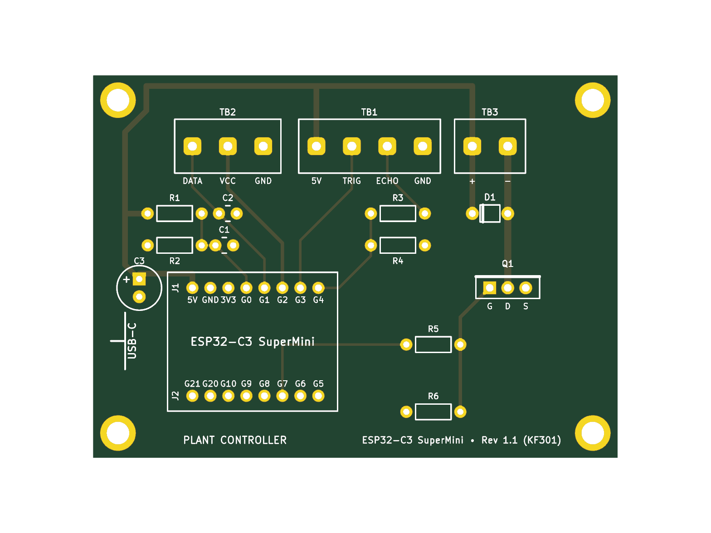
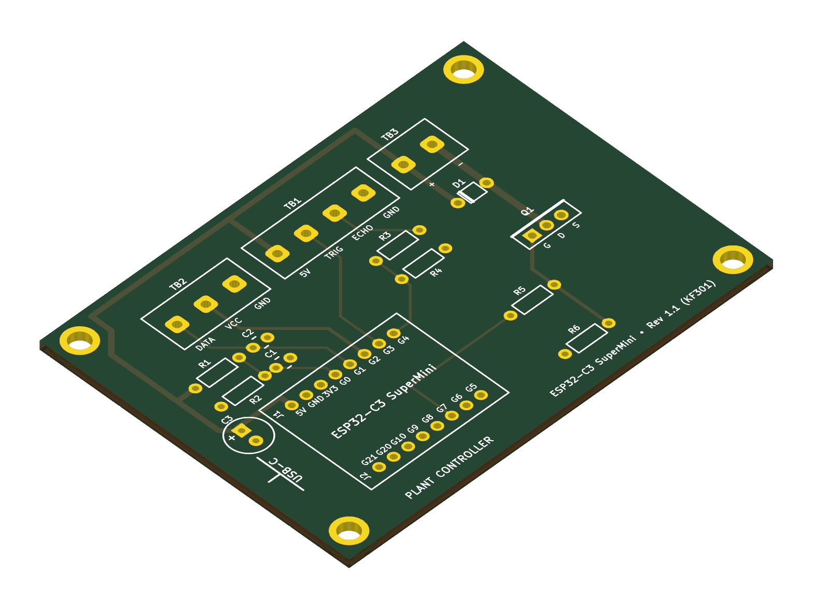
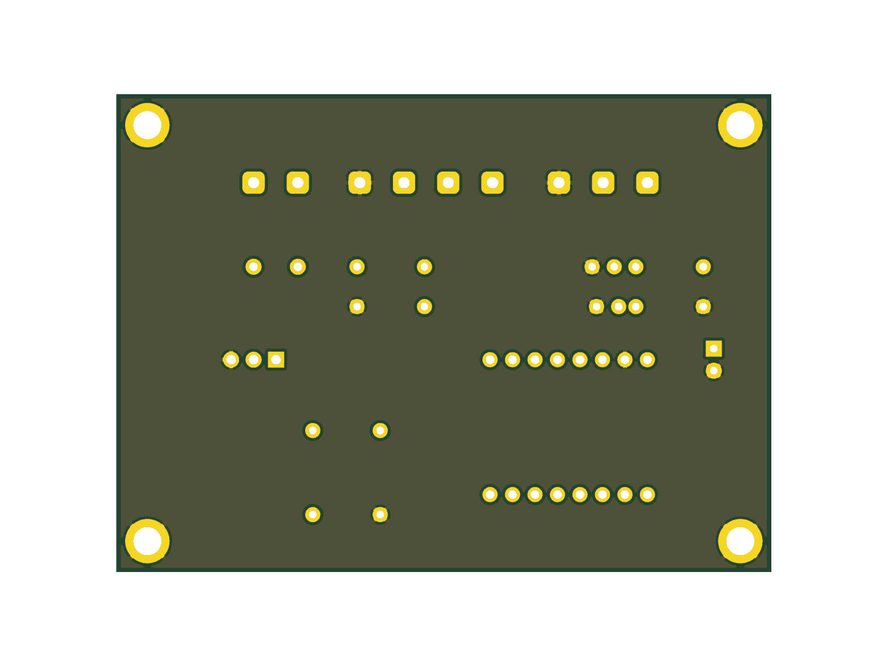

# Plant ESP32 Controller — Through-Hole Edition (Rev 2.0)

> [!IMPORTANT]
> **Canonical Pinout Reference:**
> All ESP32-C3 SuperMini hardware pinouts strictly follow the official [LastMinuteEngineers ESP32-C3 SuperMini Pinout Reference](https://lastminuteengineers.com/esp32-c3-super-mini-pinout-reference/).

This directory contains all design files, production Gerbers, prototyping visualizers, and assembly guides for the **100% Through-Hole Edition** of the Plant ESP32 watering controller.

Designed specifically for DIY hand soldering using standard through-hole parts (TO-220 MOSFET, axial 1/4W resistors, DO-41 diode, radial electrolytic capacitor).

---

## 3D Previews

| Top View (THT Components & Silkscreen) | Isometric 3D View (THT) |
| :---: | :---: |
|  |  |

| Bottom View (Solid Ground Plane Pour & Power Routing) |
| :---: |
|  |

---

## Prototyping & Visualizer Tools

* 🔌 **Breadboard Visualizer**: [`circuit_diagram.html`](circuit_diagram.html) — Interactive 15-column breadboard SVG wiring diagram & BOM.
* 📋 **Breadboard Assembly Guide**: [`breadboard_circuit_guide.md`](breadboard_circuit_guide.md) — Step-by-step breadboard wiring instructions.
* 🎛️ **Perfboard Visualizer**: [`perfboard_diagram.html`](perfboard_diagram.html) — Interactive 18×24 soldered perfboard SVG visualizer (Top, Bottom Mirrored, and X-Ray views).
* 📖 **Perfboard Assembly Guide**: [`perfboard_circuit_guide.md`](perfboard_circuit_guide.md) — Permanent perfboard assembly and wiring instructions.

---

## Bill of Materials (BOM)

| Designator | Description / Value | Footprint / Pitch | Recommended Part / Notes |
| :--- | :--- | :--- | :--- |
| **ESP32** | ESP32-C3 SuperMini module | 2× 1x8 Female Pin Header (2.54 mm pitch, 15.24 mm spacing) | ESP32-C3 SuperMini |
| **TB1** | 4-Pin Screw Terminal Block | **KF301-4P** (or 2× KF301-2P spliced), 5.00 mm pitch | Ultrasonic Sensor (5V, TRIG, ECHO, GND) |
| **TB2** | 3-Pin Screw Terminal Block | **KF301-3P**, 5.00 mm pitch | Soil Moisture Sensor (DATA, VCC, GND) |
| **TB3** | 2-Pin Screw Terminal Block | **KF301-2P**, 5.00 mm pitch | 5V Submersible Pump (+5V, Drain -) |
| **Q1** | N-Channel Power MOSFET | TO-220-3 Vertical | **FQP30N06L** / IRLZ44N (Logic-Level, $V_{GS(th)} \le 2.5\text{V}$) |
| **D1** | Flyback Protection Diode | DO-41 Horizontal (7.62 mm pitch) | **1N4001** (or 1N4002–1N4007, 1A DO-41) |
| **R1, R2** | 10 kΩ Resistor (1/4W) | Axial DIN0207 (7.62 mm pitch) | Supply Voltage Divider ($V_{in} \to$ GPIO0) |
| **R3** | 1 kΩ Resistor (1/4W) | Axial DIN0207 (7.62 mm pitch) | Echo Divider High-Side (Echo 5V $\to$ GPIO4) |
| **R4** | 2 kΩ Resistor (1/4W) | Axial DIN0207 (7.62 mm pitch) | Echo Divider Low-Side (GPIO4 $\to$ GND) |
| **R5** | 1 kΩ Resistor (1/4W) | Axial DIN0207 (7.62 mm pitch) | Gate In-Rush Current Limiter (GPIO7 $\to$ Gate) |
| **R6** | 100 kΩ Resistor (1/4W) | Axial DIN0207 (7.62 mm pitch) | Gate Pull-Down Bleeder (Gate $\to$ GND) |
| **C1** | 100 nF (0.1 µF) Ceramic Capacitor | Disc 2.5 mm pitch | ADC Smoothing Filter |
| **C2** | 100 nF (0.1 µF) Ceramic Capacitor | Disc 2.5 mm pitch | Soil Sensor Analog RF Noise Filter |
| **C3** | 100 µF Electrolytic Capacitor (16V–25V) | Radial D6.3 mm, 2.5 mm pitch | 5V Power Rail Transient Bulk Decoupling |
| **H1–H4** | 4× M3 Standoffs / Screws | 3.2 mm hole | M3 nylon or brass PCB standoffs (10–15 mm) |

---

## Production Files

* 📦 **Gerber & Drill Package**: [`plant-esp32_gerbers.zip`](plant-esp32_gerbers.zip)
* 📐 **KiCad PCB File**: [`plant-esp32.kicad_pcb`](plant-esp32.kicad_pcb)
* 📄 **KiCad Schematic**: [`plant-esp32.kicad_sch`](plant-esp32.kicad_sch)
* 🛡️ **DRC Verification Report**: [`drc_report.txt`](drc_report.txt) (**0 Errors, 0 Warnings, 0 Unconnected Nets**)
* 🐍 **Generator Script**: [`generate_pcb.py`](generate_pcb.py)
