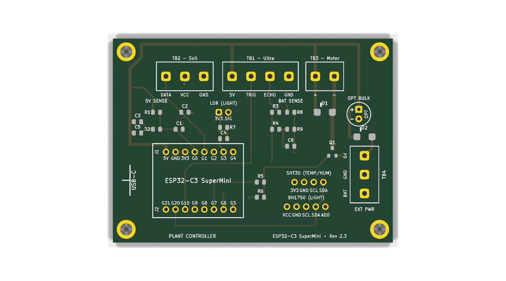
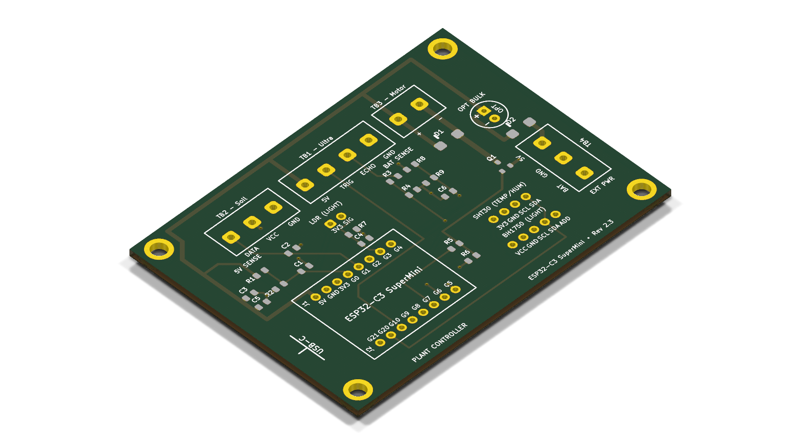
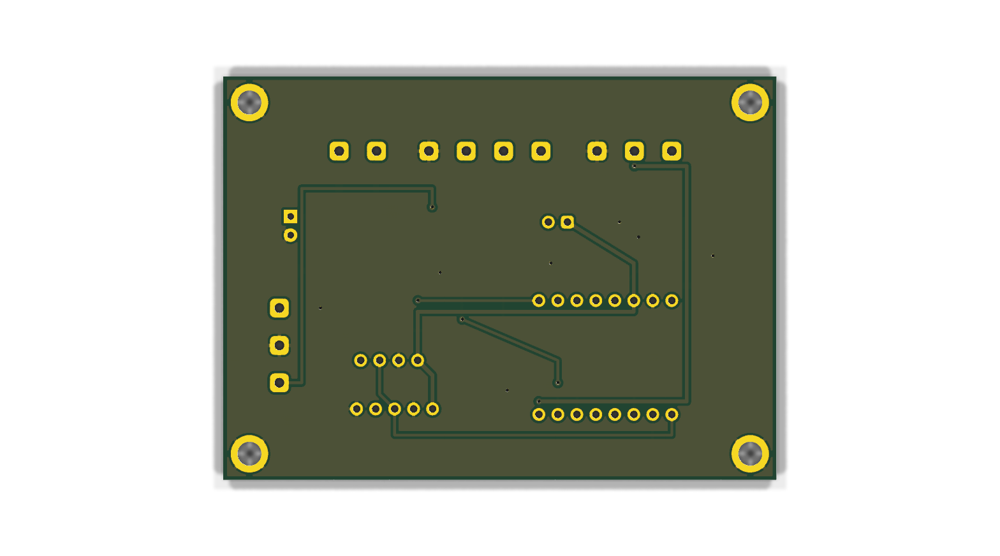

# Plant ESP32 Controller — Turnkey SMD / PCBA Edition (Rev 2.3)

This directory contains the production files, Pick & Place centroid files, Bill of Materials, and KiCad designs for the **Turnkey Surface Mount (SMD) Edition** of the Plant ESP32 watering controller.

Optimized specifically for **JLCPCB SMT Assembly** using **100% Basic Parts Library components** for zero feeder change fees ($0 setup fees).

---

## 3D Previews & Interactive Diagram

| Top View (SMD Components & Silkscreen) | Isometric 3D View (SMD) |
| :---: | :---: |
|  |  |

| Bottom View (Solid Ground Plane Pour & Power Routing) |
| :---: |
|  |

👉 **Interactive SVG Circuit Diagram & Net Visualizer:** [`circuit_diagram_smd.html`](circuit_diagram_smd.html)

---

## Architectural Highlights (Rev 2.3)

* **100% Top-Side SMT Placement**: All SMD parts are on the `F.Cu` / `F.Paste` layer, requiring only single-sided stencil setup ($0 double-sided setup fees).
* **100% Basic Parts Library ($0 Feeder Fees)**: All 8 unique SMD parts (R1–R9, C1–C6, D1, D2, Q1) are selected from JLCPCB's permanent Basic Parts catalog. Total feeder setup fee: **\$0.00**.
* **Authoritative Pinout Reference**: All pins match the official [LastMinuteEngineers ESP32-C3 SuperMini Pinout Reference](https://lastminuteengineers.com/esp32-c3-super-mini-pinout-reference/).
* **Dedicated Dual ADC Voltage Monitoring (Zero Jumpers!)**:
  * **No selector header or jumper shunt required (`JP1` eliminated completely)**. Both voltages are sampled concurrently in real time by firmware!
  * **5V Supply Rail Monitor (GPIO 4 / `ADC1_CH4`)**: Dedicated 100 kΩ / 100 kΩ divider (`R1`, `R2`, `#C149504`) + 100 nF filter (`C1`, `#C28233`). Monitors USB/Mains 5V health and detects pump brownouts.
  * **18650 Battery Monitor (GPIO 0 / `ADC1_CH0`)**: Dedicated 100 kΩ / 100 kΩ divider (`R8`, `R9`, `#C149504`) + 100 nF filter (`C6`, `#C28233`). Directly measures raw 18650 Li-ion battery voltage ($3.0\text{V}\text{–}4.2\text{V}$) from `TB4 Pin 3 (BAT)`. Quiescent drain is **only 21 µA** ($\sim 15\text{ mAh}$ per month), far below the battery's chemical self-discharge!
  * Both channels reside on **ADC1**, guaranteeing 100% reliable concurrent analog reads during active Wi-Fi streaming.
* **External Solar / 18650 Battery Power Terminal (`TB4`, DNP)**:
  * 3-pin KF301 screw terminal block (5.00 mm pitch) located on the right edge with wire entries facing outwards (`+X`).
  * **Pin 1 (`EXT_5V`)**: Regulated 5.0V power input from a solar charge & boost module (e.g. DD05CVSA mini-UPS).
  * **Pin 2 (`GND`)**: Common system ground.
  * **Pin 3 (`BAT`)**: Direct connection to the 18650 Li-ion battery positive terminal (`BAT+`) for true state-of-charge monitoring.
* **Anti-Backfeeding Schottky Diode Protection (`D2`)**:
  * **SS34** (SMA / DO-214AC package, 40V 3A Schottky rectifier, JLCPCB Basic Part `#C8678`, \$0 fee).
  * Placed in series between `TB4-1` (`EXT_5V`) and the internal `+5V` power rail.
  * When USB-C is plugged into the ESP32 while the battery/solar module is connected, `D2` is reverse-biased and **physically blocks 100% of reverse current** from backfeeding into the booster or solar charger.
  * Ultra-low forward drop ($\sim 0.25\text{–}0.35\text{V}$) delivers $\sim 4.75\text{V}$ to the board under pump load, well above the 3.5V ESP32 LDO brownout limit.
* **Flyback Diode (`D1`)**: **SS34** (SMA / DO-214AC package, 40V 3A Schottky rectifier, JLCPCB Basic Part `#C8678`, shared reel with D2).
* **Logic-Level High-Current MOSFET (`Q1`)**: **AO3400A** (SOT-23-3, 30V 5.7A, $V_{GS(th)} \approx 0.65\text{–}1.45\text{V}$, $R_{DS(on)} < 0.033\,\Omega$, LCSC `#C20917`). Gate driven by **GPIO 10**.
* **Dual-Stage Brownout & High-Frequency Decoupling**:
  * **Factory Pre-Soldered Ceramics (`C3`, `C5`)**: 2× 10 µF 25V 0805 MLCCs (LCSC `#C15850`, Basic Part, $0 fee). Total 20 µF with ultra-low ESR ($< 0.02\,\Omega$) handles microsecond motor startup dips and Wi-Fi bursts.
  * **Through-Hole Brownout Expansion (`C_EXT`, DNP)**: 2.50 mm pitch radial footprint (labeled `OPT BULK` on silkscreen, supporting Ø6.3 mm to Ø10.0 mm cans) located on the far right directly adjacent to pump terminal TB3 (>55 mm away from the ESP32 USB-C port). Leaves the entire USB-C corridor 100% unobstructed.
* **Switched Soil Sensor Power on GPIO 21 & Analog DATA on GPIO 3**:
  * Duty-cycled soil power is assigned to `GPIO 21` (digital out on header J2-8, routed to `TB2-2`).
  * Capacitive probe analog output is sampled on `GPIO 3` (`ADC1_CH3` on header J1-5, routed from `TB2-1`).
* **Ambient Light Sensor LDR Divider on GPIO 1 (`ADC1_CH1`)**:
  * **Zero Boot Strapping Risk**: Placed on **GPIO 1** (`ADC1_CH1`) to completely eliminate boot hangs.
  * **LDR1 (DNP)**: 2-pin through-hole footprint (2.54 mm pitch) for **GL5506, GL5516, GL5528, GL5537, GL5539** photoresistors.
  * **R7 (10 kΩ 0805 SMD)**: Factory pre-soldered basic part ($V_{out} \to$ GPIO 1).
  * **C4 (100 nF 0805 SMD)**: Factory pre-soldered basic part for AC light flicker suppression.
  * **100% Wi-Fi Safe**: Because GPIO 1 is on **ADC1**, `analogRead(1)` functions seamlessly while Wi-Fi is actively streaming.
* **Ultrasonic Sensor on GPIO 7 (TRIG) & GPIO 20 (ECHO)**:
  * Ultrasonic TRIG is assigned to **GPIO 7** (digital out on header J2-3, routed to `TB1-2`).
  * Ultrasonic ECHO is assigned to **GPIO 20** via the 1k/2k 0805 level divider (`TB1-3` $\to$ R3/R4 $\to$ J2-7).
* **GPIO 2 Left Unconnected**: Protected strapping pin left free on header J1-6 to ensure rock-solid boot reliability under all conditions.
* **I2C Expansion Ports for SHT30 & BH1750 (DNP)**:
  * **MOD1 (SHT30 Socket)**: 4-pin header (`3V3`, `GND`, `SCL` $\to$ GPIO 5, `SDA` $\to$ GPIO 6).
  * **MOD2 (BH1750 Socket)**: 5-pin header (`VCC`, `GND`, `SCL` $\to$ GPIO 5, `SDA` $\to$ GPIO 6, `ADD` $\to$ GND for default `0x23` address).
  * Both headers are left unpopulated (DNP) by JLCPCB at **\$0.00 extra cost**, giving an instant drop-in upgrade path.

---

## Bill of Materials (BOM) & LCSC Part Mapping

| Designator | Value / Description | Package | JLCPCB Part # (LCSC) | Type | Role |
| :--- | :--- | :--- | :--- | :--- | :--- |
| **R1, R2, R6, R8, R9** | 100 kΩ (1%, 1/8W) | 0805 SMD | **C149504** | Basic (\$0 Fee) | 5V Divider / Battery Divider (21µA drain) / Gate Pull-Down |
| **R7** | 10 kΩ (1%, 1/8W) | 0805 SMD | **C17414** | Basic (\$0 Fee) | LDR Ambient Light Sensor Divider |
| **R3, R5** | 1 kΩ (1%, 1/8W) | 0805 SMD | **C17513** | Basic (\$0 Fee) | Echo Divider High-Side / Gate Current Limiter |
| **R4** | 2 kΩ (1%, 1/8W) | 0805 SMD | **C17604** | Basic (\$0 Fee) | Echo Divider Low-Side ($5\text{V} \to 3.3\text{V}$) |
| **C1, C2, C4, C6** | 100 nF (50V X7R) | 0805 SMD | **C28233** | Basic (\$0 Fee) | 5V ADC Filter / Soil RF Bypass / Light Filter / Battery ADC Filter |
| **C3, C5** | 10 µF (25V X5R) | 0805 SMD | **C15850** | Basic (\$0 Fee) | 5V Power Rail Transient Decoupling (20 µF Total) |
| **D1, D2** | SS34 (3A, 40V Schottky Barrier Diode) | SMA (DO-214AC) | **C8678** | Basic (\$0 Fee) | Flyback Clamping (D1) & Anti-Backfeed Diode (D2) |
| **Q1** | AO3400A (30V, 5.7A N-Channel MOSFET) | SOT-23-3 | **C20917** | Basic (\$0 Fee) | Submersible Pump Low-Side Switch |

*Hand-soldered after delivery (or left unpopulated):*
* **J1, J2**: 2× 1×8 Female Pin Header (2.54 mm pitch, through-hole)
* **TB1 (TB1 - Ultra)**: KF301-4P (5.00 mm pitch 4-pin screw terminal, Ultrasonic)
* **TB2 (TB2 - Soil)**: KF301-3P (5.00 mm pitch 3-pin screw terminal, Soil Moisture)
* **TB3 (TB3 - Motor)**: KF301-2P (5.00 mm pitch 2-pin screw terminal, 5V Water Pump)
* **TB4 (EXT PWR)**: KF301-3P (5.00 mm pitch 3-pin screw terminal, External Solar / 18650 Battery Power)
* **LDR1**: GL55xx Photoresistor (2-pin 2.54 mm through-hole, DNP)
* **MOD1**: SHT30 Temperature & Humidity Module (4-pin 2.54 mm socket, DNP)
* **MOD2**: BH1750 Ambient Light Module (5-pin 2.54 mm socket, DNP)
* **C_EXT**: 100 µF – 470 µF Radial Electrolytic (2.50 mm pitch, D6.3 mm – D8.0 mm, DNP optional brownout buffer)

---

## Production Files

* 📦 **Gerber & Drill Package**: [`plant-esp32-smd_gerbers.zip`](plant-esp32-smd_gerbers.zip)
* 📋 **SMT Assembly BOM (JLCPCB)**: [`plant-esp32-smd_bom.csv`](plant-esp32-smd_bom.csv) (SMT parts only, 100% CPL match)
* 📋 **Hand-Solder BOM**: [`plant-esp32-smd_hand_solder_bom.csv`](plant-esp32-smd_hand_solder_bom.csv) (Through-hole connectors)
* 📍 **Pick & Place Centroid File**: [`plant-esp32-smd_cpl.csv`](plant-esp32-smd_cpl.csv)
* 📐 **KiCad PCB File**: [`plant-esp32-smd.kicad_pcb`](plant-esp32-smd.kicad_pcb)
* 📄 **KiCad Schematic**: [`plant-esp32-smd.kicad_sch`](plant-esp32-smd.kicad_sch)
* 🌐 **Interactive Circuit Diagram**: [`circuit_diagram_smd.html`](circuit_diagram_smd.html)
* 🛡️ **DRC Verification Report**: [`drc_report_smd.txt`](drc_report_smd.txt) (**0 Errors, 0 Warnings, 0 Unconnected Nets**)
* 🐍 **Generator Script**: [`generate_pcb_smd.py`](generate_pcb_smd.py)

---

## Ordering on JLCPCB

1. Go to **[jlcpcb.com](https://jlcpcb.com/)** and click **"Add Gerber file"**.
2. Upload `plant-esp32-smd_gerbers.zip`. The dimensions ($74 \times 54\,\text{mm}$) and 2 layers are automatically detected.
3. Under **PCB Assembly**, toggle **"PCB Assembly"** to **ON**:
   * **Assembly Side**: Top Side
   * **PCBA Qty**: 5 (or 2)
   * **Tooling Holes**: Added by JLCPCB
4. Proceed to the SMT component upload page:
   * **BOM File**: Upload `plant-esp32-smd_bom.csv`
   * **CPL / Centroid File**: Upload `plant-esp32-smd_cpl.csv`
5. Review matched components:
   * All 9 unique SMD parts match directly to their pre-assigned LCSC part numbers.
   * Feeder setup fees show as **\$0.00**.
6. Review the Component Placement preview screen and confirm alignments.
7. Checkout. When boards arrive, hand-solder the screw terminals and headers as needed.
